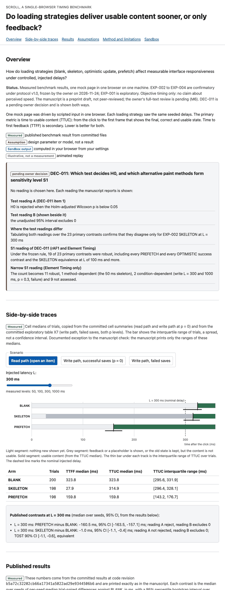

<!-- SPDX-License-Identifier: LicenseRef-SCROLL-NC-Research-1.0 -->
# SCROLL

**Question:** how do loading strategies (blank, skeleton, optimistic update, prefetch) affect measurable interface responsiveness under controlled, injected delays?

**Status, 2026-11-25 (M5).** Confirmatory results exist for EXP-002 to EXP-004 under protocol v1.0, frozen by the owner on 2026-11-24; EXP-001 is exploratory. The manuscript (`research/paper/manuscript.md`) is a preprint draft, not peer-reviewed; the owner's full-text review is pending (M6). One owner decision is pending and is shown both ways below. Nothing has been published.

## Why it matters

Loading strategies are often chosen because they look faster. This project measures, in a controlled local benchmark, what they change objectively: time to usable content (TTUC, the primary metric), time to first feedback, layout shift and wrong-state exposure. It makes no claim about how fast an interface feels to people.



## Key findings (one mock page, one browser, one machine)

All numbers below are printed in the manuscript; contrasts are medians over 20 seeds of per-seed median trial-paired differences against the blank baseline, with 95% bootstrap intervals.

- **Prefetching** with a 150 ms hover lead reduced TTUC at every delay, by 50.0 to 160.5 ms (Holm-adjusted p at most 0.00053), close to the mechanical expectation -min(h, L). For example -160.5 ms, 95% CI [-163.5, -157.1], at L = 300 ms.
- **Optimistic update** reached the final state about one delay earlier on every successful save (for example -998.6 ms, 95% CI [-1012.2, -972.6], at L = 1000 ms). On failed saves no TTUC difference was detected (estimates -1.6 to 2.7 ms; no equivalence test was registered), but the optimistic arm displayed a false state for a median of 83.4, 283.9 and 999.1 ms at L = 100, 300 and 1000 ms.
- **Skeleton** was equivalent to the blank baseline within 17 ms at delays of 100 ms and more (estimates -1.0 to 0.0 ms), while it lowered first feedback to about 28 ms. At 50 ms it was 16.7 ms faster under the main paint-time method (95% CI [-17.1, -16.0]), but this verdict changed under both alternative methods and is **not robust**; no skeleton benefit is reported.
- **Sensitivity (EXP-004):** read literally, the protocol's contradiction criterion is met for four contrasts (the 50 ms skeleton result and three null failure strata); the manuscript reports the main interpretation as qualified, a post hoc judgement.

Null and non-robust results are reported with the same weight as positive ones. Objective timing is not perceived speed.

### Pending owner decision (not chosen here)

**DEC-011, pending owner decision.** It fixes which test decides H0 and which alternative paint methods form sensitivity level S1. Both readings are reported:

- Test reading A (Holm-adjusted Wilcoxon p below 0.05) and reading B (the unadjusted 95% interval excludes 0) disagree for one of 23 contrasts, EXP-002 SKELETON at L = 300 ms.
- S1 with rAF1 and Element Timing (DEC-011): 19 of 23 primary contrasts robust. S1 with Element Timing only: 11 robust, 1 method-dependent, 2 condition-dependent and 9 not assessed.

## Experiments

| ID | Experiment | Status | Report |
|---|---|---|---|
| EXP-001 | Smoke run and instrumentation validation | exploratory (not frozen), two runs; checks C1 to C4 passed | [`report`](research/experiments/EXP-001/report.md) |
| EXP-002 | Read path: BLANK vs SKELETON vs PREFETCH | confirmatory, complete (240/240 sessions) | [`report`](research/experiments/EXP-002/report.md) |
| EXP-003 | Write path: BLANK vs OPTIMISTIC with failures | confirmatory, complete (360/360 sessions) | [`report`](research/experiments/EXP-003/report.md) |
| EXP-004 | Sensitivity analyses | confirmatory, complete (360/360 sessions) | [`report`](research/experiments/EXP-004/report.md) |

## Research navigation

- Manuscript (preprint draft, not peer-reviewed): [`research/paper/manuscript.md`](research/paper/manuscript.md); supplement: [`research/paper/supplementary.md`](research/paper/supplementary.md)
- Protocol (frozen v1.0): [`research/protocol.md`](research/protocol.md); freeze record: [`research/freeze.json`](research/freeze.json)
- Claims register: [`research/claims_register.csv`](research/claims_register.csv); artifact manifest: [`research/publication/artifact_manifest.json`](research/publication/artifact_manifest.json)
- Limitations: [`research/limitations.md`](research/limitations.md); decisions: [`research/decision_log.md`](research/decision_log.md)
- Article drafts (not published): [`articles/medium.md`](articles/medium.md), [`articles/linkedin.md`](articles/linkedin.md)
- Roadmap and session journal: [`roadmap.md`](roadmap.md), [`progress.md`](progress.md)

## What is implemented

- `src/web/`: one mock page; the loading strategy is the only switch. `src/scroll/`: seeded schedule, Playwright harness on the installed Chrome, metrics, statistics, inference, versioned result schema, run manifests, report generator and CLI.
- `demo/`: a static, offline results page (TypeScript, React, Vite) with side-by-side measured traces and a latency slider, every published contrast with its interval, the pending decision, assumptions, limitations, and a sandbox. The sandbox is an exact port of the seeded schedule and reference model (checked against the Python engine); it computes lower bounds and measures nothing. Its animated replay is labelled illustrative, not a measurement. The page collects nothing and contacts no other host.

## Quick start

Python (after `uv sync --frozen`):

```
PYTHONPATH=src .venv/bin/python -m scroll test              # test suite (launches Chrome for the browser tests)
PYTHONPATH=src .venv/bin/python -m scroll smoke --report    # exploratory toolchain smoke run
.venv/bin/python scripts/export_demo_data.py --check        # demo data matches the committed results
```

Demo (Node 22):

```
cd demo && npm ci && npm run build && npm run preview
```

Full reproduction: each experiment report's section 12 lists the commands. Confirmatory configurations run only if they match the frozen configurations in `research/freeze.json`.

## Data

All experimental data are synthetic and generated locally from seeds. See [`data/manifest.json`](data/manifest.json). Raw results with SHA-256 manifests are under `results/raw/`.

## Limitations

One synthetic page, one browser version (Chrome 158.0.8127.38), one laptop, mostly headless; synthetic delays and scripted input; frame-scale effects depend on the paint-time method. The full list is in [`research/limitations.md`](research/limitations.md).

## Owner placeholders

Repository URL and demo URL: `[OWNER PLACEHOLDER: not yet published]`. Funding, competing interests, author line and affiliation: `[OWNER PLACEHOLDER]` (see the manuscript). The manuscript title is proposed and awaits the owner's approval.

## Licence

Source-available, non-commercial research licence: SCROLL Source-Available Non-Commercial Research License v1.0 ([LICENSE](LICENSE), [NOTICE.md](NOTICE.md)). It is not an OSI-approved open-source licence. Third-party material keeps its own terms.

## Citation

See [`CITATION.cff`](CITATION.cff). An AI system was used as a research and development assistant; it is not an author.
