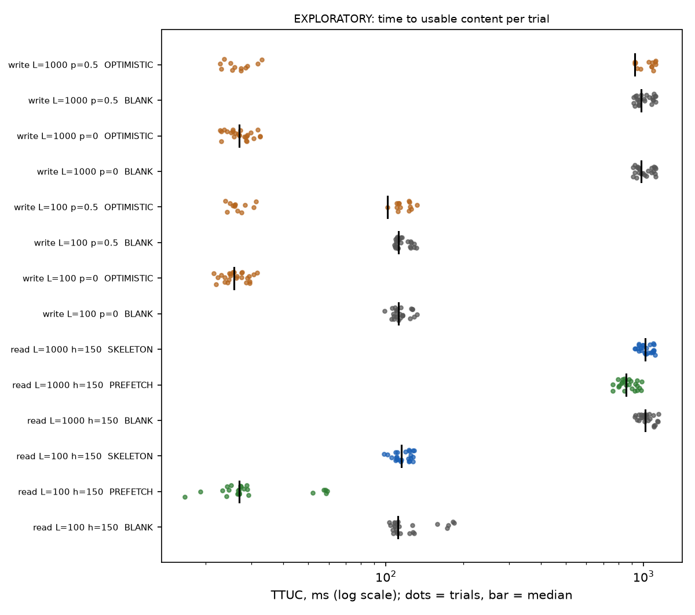
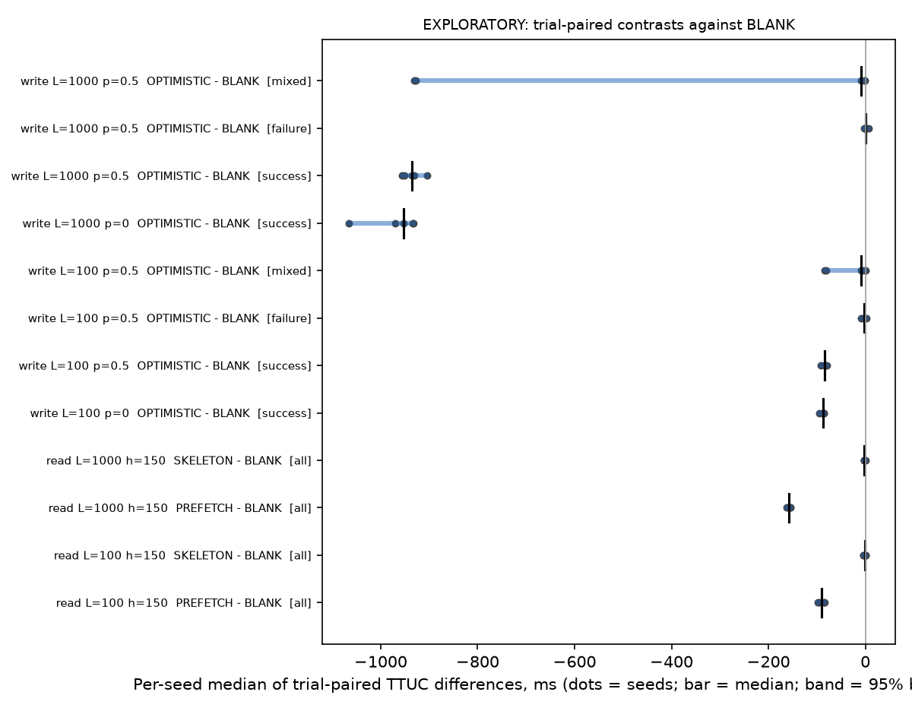
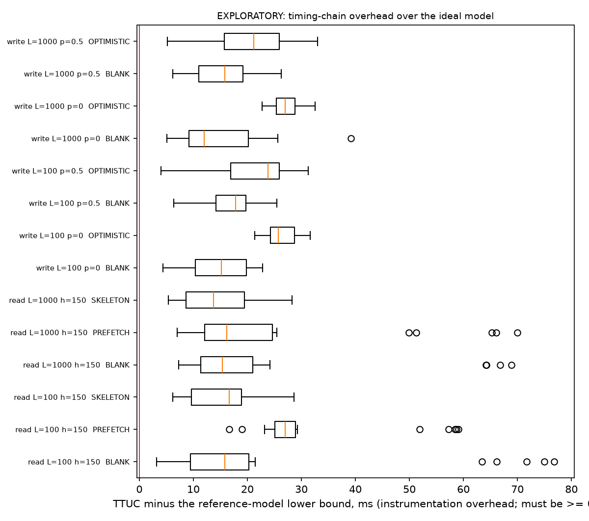

<!-- SPDX-License-Identifier: LicenseRef-SCROLL-NC-Research-1.0 -->
# EXPLORATORY run report: EXP-001-20261125T065102Z

**EXPLORATORY. Pre-freeze run; not evidence for any research hypothesis. Never cite these numbers as findings.**

Generated by `python -m scroll report` from `results.json` (SHA-256 `361494a4a9dd713876680eff26b55b01e6054e1f08df739c778e6f3e1c3356e1`). Every number below is computed from that file.

## Run

| Experiment | Config hash (prefix) | Code revision | Browser | Runtime (s) | Load avg start | Load avg end | Peak RSS Python (MiB) |
|---|---|---|---|---|---|---|---|
| EXP-001 | f39023e2ef11d9ea | 7c8f7d10d1 (dirty) | chrome 158.0.8127.38 headless=True cpu=1x | 645.4 | [1.98, 4.69, 13.26] | [1.27, 1.85, 7.05] | 54.1 |

Platform: Apple M1 Pro, 10 logical CPUs, Darwin 15.3.1. Other processes (including other agents) were running during the run, so wall-clock and timing values are noisy.

## Cell summaries (trial level, descriptive)

| Cell | Arm | Trials ok | Excl. | Seeds | TTUC median (ms) | Q1 | Q3 | SD of seed medians | TTFF median | Excess min | Excess median |
|---|---|---|---|---|---|---|---|---|---|---|---|
| read L=100 h=150 | BLANK | 24 | 1 | 5 | 111.1 | 108.2 | 127.7 | 7.0 | 111.1 | 3.2 | 15.8 |
| read L=100 h=150 | PREFETCH | 25 | 0 | 5 | 27.0 | 25.1 | 28.9 | 0.8 | 27.0 | 16.6 | 27.0 |
| read L=100 h=150 | SKELETON | 25 | 0 | 5 | 115.0 | 109.9 | 123.6 | 5.4 | 27.4 | 6.2 | 16.6 |
| read L=1000 h=150 | BLANK | 25 | 0 | 5 | 1012.3 | 978.6 | 1091.9 | 50.3 | 1012.3 | 7.3 | 15.4 |
| read L=1000 h=150 | PREFETCH | 25 | 0 | 5 | 855.1 | 826.0 | 928.6 | 49.5 | 855.1 | 7.0 | 16.2 |
| read L=1000 h=150 | SKELETON | 25 | 0 | 5 | 1015.2 | 975.7 | 1079.3 | 54.3 | 27.3 | 5.4 | 13.7 |
| write L=100 p=0 | BLANK | 25 | 0 | 5 | 111.6 | 108.5 | 116.1 | 5.6 | 111.6 | 4.4 | 15.2 |
| write L=100 p=0 | OPTIMISTIC | 25 | 0 | 5 | 25.7 | 24.3 | 28.7 | 1.5 | 25.7 | 21.4 | 25.7 |
| write L=100 p=0.5 | BLANK | 25 | 0 | 5 | 111.8 | 110.0 | 123.8 | 4.6 | 111.8 | 6.4 | 17.8 |
| write L=100 p=0.5 | OPTIMISTIC | 25 | 0 | 5 | 101.6 | 26.0 | 113.9 | 46.0 | 26.0 | 4.0 | 23.8 |
| write L=1000 p=0 | BLANK | 25 | 0 | 5 | 978.0 | 948.8 | 1075.6 | 54.4 | 978.0 | 5.1 | 12.0 |
| write L=1000 p=0 | OPTIMISTIC | 25 | 0 | 5 | 27.0 | 25.4 | 28.8 | 1.3 | 27.0 | 22.7 | 27.0 |
| write L=1000 p=0.5 | BLANK | 25 | 0 | 5 | 977.0 | 955.0 | 1084.6 | 52.8 | 977.0 | 6.2 | 15.8 |
| write L=1000 p=0.5 | OPTIMISTIC | 25 | 0 | 5 | 926.2 | 27.3 | 1074.7 | 529.0 | 27.3 | 5.2 | 21.2 |

| Cell | Arm | Element - rAF2 (ms) | Event <16 ms share (descriptive) | Input to handler (ms) | Hover-lead excl. | Shift all (median) | Shift CLS-eligible (median) | Wrong-state (ms) | False-state (ms) | Failures | Final correct | Prefetch hit | Defects |
|---|---|---|---|---|---|---|---|---|---|---|---|---|---|
| read L=100 h=150 | BLANK | -0.050 | 0.833 | 0.300 | 1 | 0.035 | 0.000 | n/a | n/a | 0 | 1.000 | n/a | 0 |
| read L=100 h=150 | PREFETCH | -9.300 | 0.160 | 0.300 | 0 | 0.035 | 0.000 | n/a | n/a | 0 | 1.000 | 1.000 | 0 |
| read L=100 h=150 | SKELETON | -5.100 | 0.280 | 0.300 | 0 | 0.035 | 0.000 | n/a | n/a | 0 | 1.000 | n/a | 0 |
| read L=1000 h=150 | BLANK | -1.600 | 0.840 | 0.300 | 0 | 0.035 | 0.035 | n/a | n/a | 0 | 1.000 | n/a | 0 |
| read L=1000 h=150 | PREFETCH | -1.900 | 0.840 | 0.300 | 0 | 0.035 | 0.035 | n/a | n/a | 0 | 1.000 | 1.000 | 0 |
| read L=1000 h=150 | SKELETON | 1.200 | 0.200 | 0.200 | 0 | 0.035 | 0.000 | n/a | n/a | 0 | 1.000 | n/a | 0 |
| write L=100 p=0 | BLANK | n/a | 0.680 | 0.300 | 0 | 0.000 | 0.000 | 111.600 | 0.000 | 0 | 1.000 | n/a | 0 |
| write L=100 p=0 | OPTIMISTIC | n/a | 0.480 | 0.300 | 0 | 0.000 | 0.000 | 25.700 | 0.000 | 0 | 1.000 | n/a | 0 |
| write L=100 p=0.5 | BLANK | n/a | 0.800 | 0.300 | 0 | 0.000 | 0.000 | 0.000 | 0.000 | 13 | 1.000 | n/a | 0 |
| write L=100 p=0.5 | OPTIMISTIC | n/a | 0.400 | 0.300 | 0 | 0.000 | 0.000 | 81.400 | 81.400 | 13 | 1.000 | n/a | 0 |
| write L=1000 p=0 | BLANK | n/a | 0.800 | 0.200 | 0 | 0.000 | 0.000 | 978.000 | 0.000 | 0 | 1.000 | n/a | 0 |
| write L=1000 p=0 | OPTIMISTIC | n/a | 0.320 | 0.300 | 0 | 0.000 | 0.000 | 27.000 | 0.000 | 0 | 1.000 | n/a | 0 |
| write L=1000 p=0.5 | BLANK | n/a | 0.800 | 0.300 | 0 | 0.000 | 0.000 | 0.000 | 0.000 | 13 | 1.000 | n/a | 0 |
| write L=1000 p=0.5 | OPTIMISTIC | n/a | 0.480 | 0.300 | 0 | 0.000 | 0.000 | 898.900 | 898.900 | 13 | 1.000 | n/a | 0 |

## Primary estimand: trial-paired contrasts (amendments A1 and A2)

Unit: the seed. Within a seed and cell, interaction k of an arm is paired with interaction k of BLANK (same scheduled delay and outcome); the seed contributes the median of its paired differences. Write cells with p > 0 are split by outcome (success, failure; primary) and also shown mixed (secondary). Intervals are 95% percentile bootstrap over seeds (10,000 resamples, seed 20261124). Descriptive only: no hypothesis tests on exploratory data.

| Cell | Contrast | Stratum | Role | Seeds | Trial pairs | Median diff (ms) | CI low | CI high | sigma_d (ms) | n req. |
|---|---|---|---|---|---|---|---|---|---|---|
| read L=100 h=150 | PREFETCH - BLANK | all | primary | 5 | 24 | -90.2 | -98.1 | -84.5 | 5.8 | 1 |
| read L=100 h=150 | SKELETON - BLANK | all | primary | 5 | 24 | -0.2 | -4.3 | 0.8 | 2.3 | 1 |
| read L=1000 h=150 | PREFETCH - BLANK | all | primary | 5 | 25 | -157.2 | -163.3 | -154.5 | 3.6 | 1 |
| read L=1000 h=150 | SKELETON - BLANK | all | primary | 5 | 25 | -1.9 | -3.2 | -0.1 | 1.3 | 1 |
| write L=100 p=0 | OPTIMISTIC - BLANK | success | primary | 5 | 25 | -86.7 | -95.5 | -85.3 | 4.1 | 1 |
| write L=100 p=0.5 | OPTIMISTIC - BLANK | success | primary | 5 | 12 | -83.4 | -91.8 | -79.5 | 4.6 | 1 |
| write L=100 p=0.5 | OPTIMISTIC - BLANK | failure | primary | 4 | 13 | -2.8 | -8.3 | 2.1 | 4.3 | 1 |
| write L=100 p=0.5 | OPTIMISTIC - BLANK | mixed | secondary | 5 | 25 | -8.9 | -84.2 | 0.4 | 43.1 | 51 |
| write L=1000 p=0 | OPTIMISTIC - BLANK | success | primary | 5 | 25 | -953.0 | -1066.3 | -932.3 | 55.3 | 84 |
| write L=1000 p=0.5 | OPTIMISTIC - BLANK | success | primary | 5 | 12 | -936.3 | -956.2 | -903.8 | 20.6 | 12 |
| write L=1000 p=0.5 | OPTIMISTIC - BLANK | failure | primary | 4 | 13 | 0.5 | -2.4 | 7.2 | 4.4 | 1 |
| write L=1000 p=0.5 | OPTIMISTIC - BLANK | mixed | secondary | 5 | 25 | -8.1 | -930.5 | -1.5 | 506.5 | 6969 |

## Secondary: draft seed-median estimand (descriptive)

Each seed contributes the median TTUC of its session; differences are arm minus BLANK for the same seed and cell. Intervals are 95% percentile bootstrap over seeds (10,000 resamples, seed 20261124). `n req.` is the protocol 5.1 formula with delta = 17 ms, alpha 0.05, power 0.80.

| Cell | Contrast | Pairs | Median diff (ms) | CI low | CI high | sigma_d (ms) | sigma_d CI high | n req. | n req. (CI high) | Median diff, rAF1 | Median diff, Element |
|---|---|---|---|---|---|---|---|---|---|---|---|
| read L=100 h=150 | PREFETCH - BLANK | 5 | -86.6 | -99.6 | -83.0 | 6.8 | 9.0 | 2 | 3 | -84.8 | -96.2 |
| read L=100 h=150 | SKELETON - BLANK | 5 | 1.4 | -3.3 | 2.2 | 2.2 | 2.9 | 1 | 1 | 2.2 | -3.1 |
| read L=1000 h=150 | PREFETCH - BLANK | 5 | -158.9 | -168.7 | -149.9 | 8.1 | 10.0 | 2 | 3 | -163.4 | -157.6 |
| read L=1000 h=150 | SKELETON - BLANK | 5 | -1.4 | -34.3 | 1.3 | 15.1 | 19.0 | 7 | 10 | -1.4 | -0.4 |
| write L=100 p=0 | OPTIMISTIC - BLANK | 5 | -87.9 | -95.5 | -83.8 | 4.4 | 5.9 | 1 | 1 | -86.6 | n/a |
| write L=100 p=0.5 | OPTIMISTIC - BLANK | 5 | -9.0 | -85.1 | 3.2 | 43.9 | 47.1 | 53 | 61 | -8.3 | n/a |
| write L=1000 p=0 | OPTIMISTIC - BLANK | 5 | -952.5 | -1062.7 | -931.7 | 54.0 | 70.7 | 80 | 136 | -951.7 | n/a |
| write L=1000 p=0.5 | OPTIMISTIC - BLANK | 5 | -79.1 | -930.9 | -4.8 | 492.6 | 506.2 | 6591 | 6960 | -79.3 | n/a |

## Degenerate cases and warnings

- read L=100 h=150 BLANK: 1 excluded trial(s).
- read L=100 h=150 BLANK: Event Timing duration below the 16 ms threshold in 83% of trials (metric mostly unobservable; descriptive only, amendment A4).
- read L=1000 h=150 BLANK: Event Timing duration below the 16 ms threshold in 84% of trials (metric mostly unobservable; descriptive only, amendment A4).
- read L=1000 h=150 PREFETCH: Event Timing duration below the 16 ms threshold in 84% of trials (metric mostly unobservable; descriptive only, amendment A4).
- write L=100 p=0 BLANK: Event Timing duration below the 16 ms threshold in 68% of trials (metric mostly unobservable; descriptive only, amendment A4).
- write L=100 p=0.5 BLANK: Event Timing duration below the 16 ms threshold in 80% of trials (metric mostly unobservable; descriptive only, amendment A4).
- write L=1000 p=0 BLANK: Event Timing duration below the 16 ms threshold in 80% of trials (metric mostly unobservable; descriptive only, amendment A4).
- write L=1000 p=0.5 BLANK: Event Timing duration below the 16 ms threshold in 80% of trials (metric mostly unobservable; descriptive only, amendment A4).
- write L=100 p=0.5 BLANK: failures per session [4, 4, 2, 3, 0] of K=5; the per-seed median TTUC reflects only successes and mostly failures in some seeds.
- write L=100 p=0.5 OPTIMISTIC: failures per session [4, 4, 2, 3, 0] of K=5; the per-seed median TTUC reflects only successes and mostly failures in some seeds.
- write L=1000 p=0.5 BLANK: failures per session [4, 4, 2, 3, 0] of K=5; the per-seed median TTUC reflects only successes and mostly failures in some seeds.
- write L=1000 p=0.5 OPTIMISTIC: failures per session [4, 4, 2, 3, 0] of K=5; the per-seed median TTUC reflects only successes and mostly failures in some seeds.
- read L=100 h=150 PREFETCH: lead time h >= maximum delay, so the residual wait is always 0 (TTUC independent of L by construction).

## Runtime and projection

Fitted on this run: per-trial overhead median 0.072 s (90th percentile 0.117 s) beyond delay + settle + pre-input + hover lead; per-session overhead median 0.148 s; median session wall 8.90 s; median trial wall 2.009 s. Projections use the nominal latency as the delay and do not model CPU throttling or headed-mode cost.

| Experiment | Config | Sessions | Interactions | Projected (min) |
|---|---|---|---|---|
| EXP-002 | EXP-002 read path (frozen v1.0, owner-approved 2026-11-24). | 240 | 2400 | 66.0 |
| EXP-003 | EXP-003 write path (frozen v1.0, owner-approved 2026-11-24). | 360 | 3600 | 105.2 |
| EXP-004 | EXP-004 sensitivity S2, CPU throttle 4x (frozen v1.0, owner-approved 2026-11-24). | 140 | 1400 | 45.2 |
| EXP-004 | EXP-004 sensitivity S3, prefetch lead time (frozen v1.0, owner-approved 2026-11-24; S1 reuses EXP-002/003 data; S2 and S4 are browser-setting variants). | 80 | 800 | 27.8 |
| EXP-004 | EXP-004 sensitivity S4, headed browser (frozen v1.0, owner-approved 2026-11-24). | 140 | 1400 | 45.2 |

## Figures

**FIG-E1.** Time to usable content (TTUC, ms, log scale) for every analysed trial, by cell and arm. Vertical bars mark medians. Exploratory pre-freeze run; trials within a session are not independent.

**FIG-E2.** Trial-paired TTUC differences (arm minus BLANK, ms): each dot is one seed's median over its paired interactions (write cells with p > 0 split by outcome), with the median over seeds and a 95% percentile bootstrap interval over seeds.

**FIG-E3.** TTUC minus the reference-model lower bound (ms) per cell and arm; boxes show quartiles over trials. Negative values would indicate an instrumentation defect.

## Files

- `../results.json` (validated against `src/scroll/schemas/result-1.0.0.json`)
- `metrics.csv`, `cell_summary.csv`, `trial_paired_contrasts.csv`, `paired_contrasts.csv`, `runtime_projection.csv`
- `figures/`

Report generated 2026-11-25T07:02:03Z.
