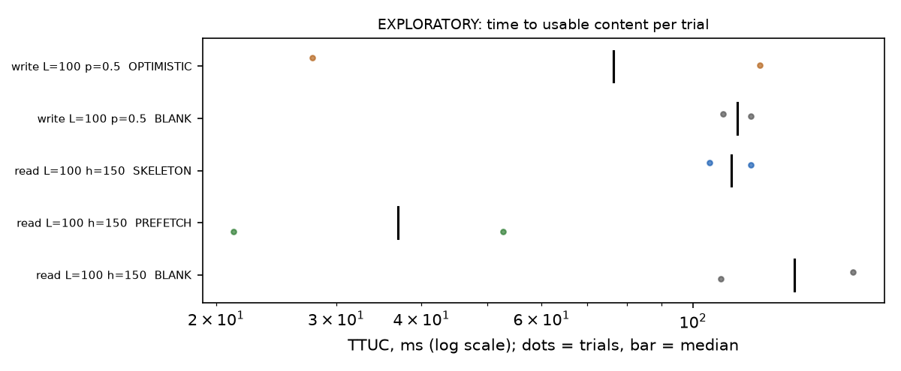
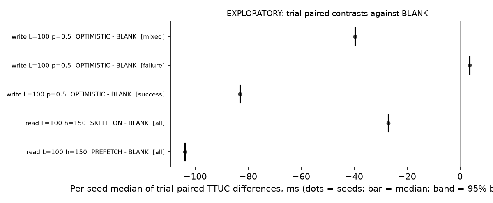
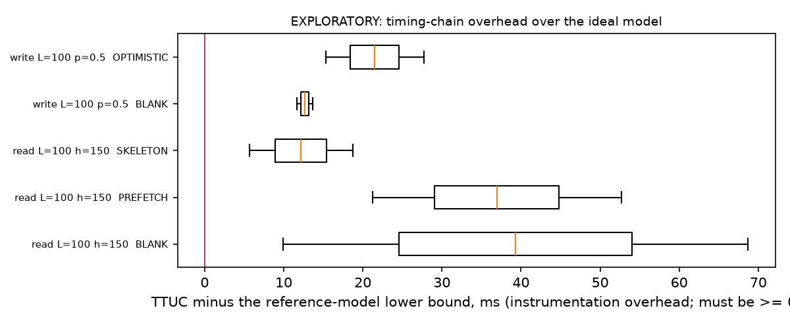

<!-- SPDX-License-Identifier: LicenseRef-SCROLL-NC-Research-1.0 -->
# EXPLORATORY run report: SMOKE-20261125T065043Z

**EXPLORATORY. Pre-freeze run; not evidence for any research hypothesis. Never cite these numbers as findings.**

Generated by `python -m scroll report` from `results.json` (SHA-256 `9ef4f4916aaee6dfe9fd672f4e73da7c3cb27eab30adae5c1bcf6693705a1c8b`). Every number below is computed from that file.

## Run

| Experiment | Config hash (prefix) | Code revision | Browser | Runtime (s) | Load avg start | Load avg end | Peak RSS Python (MiB) |
|---|---|---|---|---|---|---|---|
| SMOKE | fe63a64587a49e07 | 7c8f7d10d1 (dirty) | chrome 158.0.8127.38 headless=True cpu=1x | 7.2 | [1.67, 4.77, 13.44] | [1.62, 4.71, 13.37] | 49.4 |

Platform: Apple M1 Pro, 10 logical CPUs, Darwin 15.3.1. Other processes (including other agents) were running during the run, so wall-clock and timing values are noisy.

## Cell summaries (trial level, descriptive)

| Cell | Arm | Trials ok | Excl. | Seeds | TTUC median (ms) | Q1 | Q3 | SD of seed medians | TTFF median | Excess min | Excess median |
|---|---|---|---|---|---|---|---|---|---|---|---|
| read L=100 h=150 | BLANK | 2 | 0 | 1 | 140.8 | 125.3 | 156.3 | n/a | 140.8 | 9.9 | 39.3 |
| read L=100 h=150 | PREFETCH | 2 | 0 | 1 | 37.0 | 29.1 | 44.8 | n/a | 37.0 | 21.2 | 37.0 |
| read L=100 h=150 | SKELETON | 2 | 0 | 1 | 113.7 | 109.7 | 117.7 | n/a | 36.2 | 5.7 | 12.2 |
| write L=100 p=0.5 | BLANK | 2 | 0 | 1 | 116.2 | 113.5 | 119.0 | n/a | 116.2 | 11.7 | 12.7 |
| write L=100 p=0.5 | OPTIMISTIC | 2 | 0 | 1 | 76.5 | 52.1 | 100.9 | n/a | 26.8 | 15.3 | 21.5 |

| Cell | Arm | Element - rAF2 (ms) | Event <16 ms share (descriptive) | Input to handler (ms) | Hover-lead excl. | Shift all (median) | Shift CLS-eligible (median) | Wrong-state (ms) | False-state (ms) | Failures | Final correct | Prefetch hit | Defects |
|---|---|---|---|---|---|---|---|---|---|---|---|---|---|
| read L=100 h=150 | BLANK | -26.950 | 1.000 | 0.300 | 0 | 0.035 | 0.000 | n/a | n/a | 0 | 1.000 | n/a | 0 |
| read L=100 h=150 | PREFETCH | -2.950 | 0.500 | 0.350 | 0 | 0.035 | 0.000 | n/a | n/a | 0 | 1.000 | 1.000 | 0 |
| read L=100 h=150 | SKELETON | -1.050 | 0.500 | 0.450 | 0 | 0.035 | 0.000 | n/a | n/a | 0 | 1.000 | n/a | 0 |
| write L=100 p=0.5 | BLANK | n/a | 1.000 | 0.300 | 0 | 0.000 | 0.000 | 55.350 | 0.000 | 1 | 1.000 | n/a | 0 |
| write L=100 p=0.5 | OPTIMISTIC | n/a | 0.500 | 0.400 | 0 | 0.000 | 0.000 | 63.600 | 49.750 | 1 | 1.000 | n/a | 0 |

## Primary estimand: trial-paired contrasts (amendments A1 and A2)

Unit: the seed. Within a seed and cell, interaction k of an arm is paired with interaction k of BLANK (same scheduled delay and outcome); the seed contributes the median of its paired differences. Write cells with p > 0 are split by outcome (success, failure; primary) and also shown mixed (secondary). Intervals are 95% percentile bootstrap over seeds (10,000 resamples, seed 20261124). Descriptive only: no hypothesis tests on exploratory data.

| Cell | Contrast | Stratum | Role | Seeds | Trial pairs | Median diff (ms) | CI low | CI high | sigma_d (ms) | n req. |
|---|---|---|---|---|---|---|---|---|---|---|
| read L=100 h=150 | PREFETCH - BLANK | all | primary | 1 | 2 | -103.8 | n/a | n/a | n/a | n/a |
| read L=100 h=150 | SKELETON - BLANK | all | primary | 1 | 2 | -27.1 | n/a | n/a | n/a | n/a |
| write L=100 p=0.5 | OPTIMISTIC - BLANK | success | primary | 1 | 1 | -83.0 | n/a | n/a | n/a | n/a |
| write L=100 p=0.5 | OPTIMISTIC - BLANK | failure | primary | 1 | 1 | 3.6 | n/a | n/a | n/a | n/a |
| write L=100 p=0.5 | OPTIMISTIC - BLANK | mixed | secondary | 1 | 2 | -39.7 | n/a | n/a | n/a | n/a |

## Secondary: draft seed-median estimand (descriptive)

Each seed contributes the median TTUC of its session; differences are arm minus BLANK for the same seed and cell. Intervals are 95% percentile bootstrap over seeds (10,000 resamples, seed 20261124). `n req.` is the protocol 5.1 formula with delta = 17 ms, alpha 0.05, power 0.80.

| Cell | Contrast | Pairs | Median diff (ms) | CI low | CI high | sigma_d (ms) | sigma_d CI high | n req. | n req. (CI high) | Median diff, rAF1 | Median diff, Element |
|---|---|---|---|---|---|---|---|---|---|---|---|
| read L=100 h=150 | PREFETCH - BLANK | 1 | -103.8 | n/a | n/a | n/a | n/a | n/a | n/a | -72.3 | -79.8 |
| read L=100 h=150 | SKELETON - BLANK | 1 | -27.1 | n/a | n/a | n/a | n/a | n/a | n/a | -3.6 | -1.2 |
| write L=100 p=0.5 | OPTIMISTIC - BLANK | 1 | -39.7 | n/a | n/a | n/a | n/a | n/a | n/a | -40.4 | n/a |

## Degenerate cases and warnings

- read L=100 h=150 PREFETCH - BLANK [all]: fewer than two matched seeds; no interval.
- read L=100 h=150 SKELETON - BLANK [all]: fewer than two matched seeds; no interval.
- write L=100 p=0.5 OPTIMISTIC - BLANK [success]: fewer than two matched seeds; no interval.
- write L=100 p=0.5 OPTIMISTIC - BLANK [failure]: fewer than two matched seeds; no interval.
- write L=100 p=0.5 OPTIMISTIC - BLANK [mixed]: fewer than two matched seeds; no interval.
- read L=100 h=150 PREFETCH - BLANK: fewer than two matched seeds; no interval.
- read L=100 h=150 SKELETON - BLANK: fewer than two matched seeds; no interval.
- write L=100 p=0.5 OPTIMISTIC - BLANK: fewer than two matched seeds; no interval.
- read L=100 h=150 BLANK: Event Timing duration below the 16 ms threshold in 100% of trials (metric mostly unobservable; descriptive only, amendment A4).
- read L=100 h=150 PREFETCH: Event Timing duration below the 16 ms threshold in 50% of trials (metric mostly unobservable; descriptive only, amendment A4).
- read L=100 h=150 SKELETON: Event Timing duration below the 16 ms threshold in 50% of trials (metric mostly unobservable; descriptive only, amendment A4).
- write L=100 p=0.5 BLANK: Event Timing duration below the 16 ms threshold in 100% of trials (metric mostly unobservable; descriptive only, amendment A4).
- write L=100 p=0.5 OPTIMISTIC: Event Timing duration below the 16 ms threshold in 50% of trials (metric mostly unobservable; descriptive only, amendment A4).
- read L=100 h=150 PREFETCH: lead time h >= maximum delay, so the residual wait is always 0 (TTUC independent of L by construction).

## Runtime and projection

Fitted on this run: per-trial overhead median 0.076 s (90th percentile 0.131 s) beyond delay + settle + pre-input + hover lead; per-session overhead median 0.150 s; median session wall 1.36 s; median trial wall 0.574 s. Projections use the nominal latency as the delay and do not model CPU throttling or headed-mode cost.

| Experiment | Config | Sessions | Interactions | Projected (min) |
|---|---|---|---|---|
| EXP-002 | EXP-002 read path (frozen v1.0, owner-approved 2026-11-24). | 240 | 2400 | 66.1 |
| EXP-003 | EXP-003 write path (frozen v1.0, owner-approved 2026-11-24). | 360 | 3600 | 105.4 |
| EXP-004 | EXP-004 sensitivity S2, CPU throttle 4x (frozen v1.0, owner-approved 2026-11-24). | 140 | 1400 | 45.3 |
| EXP-004 | EXP-004 sensitivity S3, prefetch lead time (frozen v1.0, owner-approved 2026-11-24; S1 reuses EXP-002/003 data; S2 and S4 are browser-setting variants). | 80 | 800 | 27.9 |
| EXP-004 | EXP-004 sensitivity S4, headed browser (frozen v1.0, owner-approved 2026-11-24). | 140 | 1400 | 45.3 |

## Figures

**FIG-E1.** Time to usable content (TTUC, ms, log scale) for every analysed trial, by cell and arm. Vertical bars mark medians. Exploratory pre-freeze run; trials within a session are not independent.

**FIG-E2.** Trial-paired TTUC differences (arm minus BLANK, ms): each dot is one seed's median over its paired interactions (write cells with p > 0 split by outcome), with the median over seeds and a 95% percentile bootstrap interval over seeds.

**FIG-E3.** TTUC minus the reference-model lower bound (ms) per cell and arm; boxes show quartiles over trials. Negative values would indicate an instrumentation defect.

## Files

- `../results.json` (validated against `src/scroll/schemas/result-1.0.0.json`)
- `metrics.csv`, `cell_summary.csv`, `trial_paired_contrasts.csv`, `paired_contrasts.csv`, `runtime_projection.csv`
- `figures/`

Report generated 2026-11-25T06:50:51Z.
