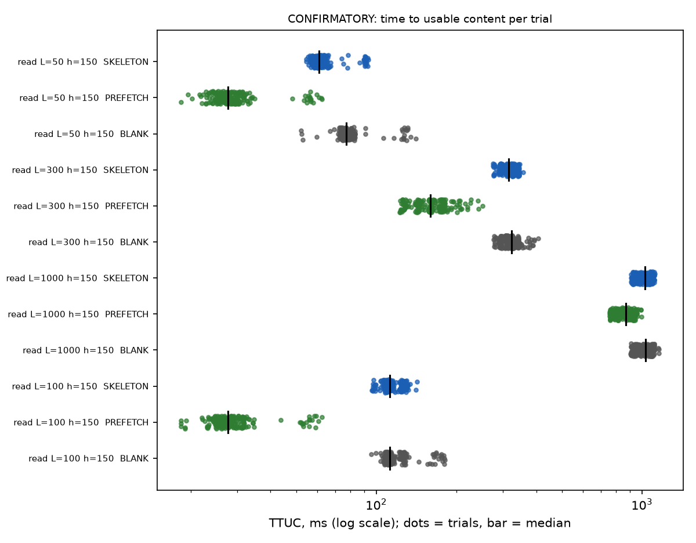
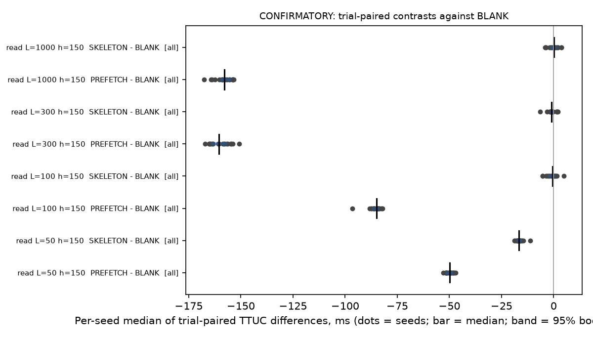
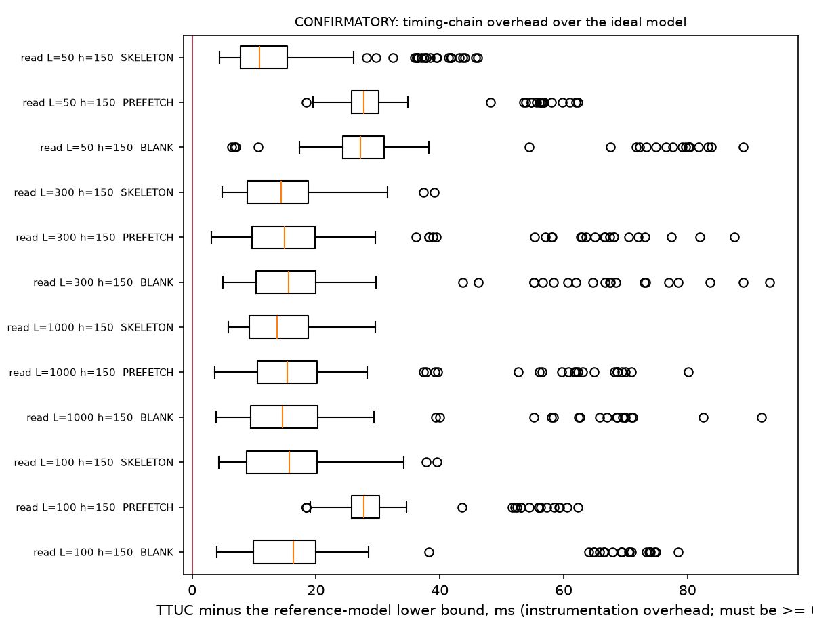

<!-- SPDX-License-Identifier: LicenseRef-SCROLL-NC-Research-1.0 -->
# CONFIRMATORY run report: EXP-002-20261125T070315Z

Generated by `python -m scroll report` from `results.json` (SHA-256 `0ca46a419b9d00b1b262f0b3f72cd4aeb342070dbb317dd8f36b89016886fce3`). Every number below is computed from that file.

## Run

| Experiment | Config hash (prefix) | Code revision | Browser | Runtime (s) | Load avg start | Load avg end | Peak RSS Python (MiB) |
|---|---|---|---|---|---|---|---|
| EXP-002 | 1040b20e1c79173c | b5a72c3220 | chrome 158.0.8127.38 headless=True cpu=1x | 3887.4 | [1.78, 1.83, 6.55] | [2.07, 1.67, 1.71] | 77.6 |

Platform: Apple M1 Pro, 10 logical CPUs, Darwin 15.3.1. Other processes (including other agents) were running during the run, so wall-clock and timing values are noisy.

## Cell summaries (trial level, descriptive)

| Cell | Arm | Trials ok | Excl. | Seeds | TTUC median (ms) | Q1 | Q3 | SD of seed medians | TTFF median | Excess min | Excess median |
|---|---|---|---|---|---|---|---|---|---|---|---|
| read L=50 h=150 | BLANK | 200 | 0 | 20 | 77.2 | 75.2 | 79.9 | 1.1 | 77.2 | 6.4 | 27.2 |
| read L=50 h=150 | PREFETCH | 199 | 1 | 20 | 27.7 | 25.8 | 30.1 | 1.4 | 27.7 | 18.4 | 27.7 |
| read L=50 h=150 | SKELETON | 200 | 0 | 20 | 60.9 | 59.2 | 63.7 | 1.2 | 27.5 | 4.4 | 10.9 |
| read L=100 h=150 | BLANK | 198 | 2 | 20 | 112.4 | 109.8 | 125.3 | 3.1 | 112.4 | 4.0 | 16.3 |
| read L=100 h=150 | PREFETCH | 199 | 1 | 20 | 27.7 | 25.8 | 30.2 | 1.2 | 27.7 | 18.4 | 27.7 |
| read L=100 h=150 | SKELETON | 198 | 2 | 20 | 112.3 | 109.2 | 124.3 | 4.1 | 28.0 | 4.3 | 15.7 |
| read L=300 h=150 | BLANK | 200 | 0 | 20 | 323.8 | 295.6 | 331.9 | 9.9 | 323.8 | 5.0 | 15.6 |
| read L=300 h=150 | PREFETCH | 199 | 1 | 20 | 159.8 | 143.2 | 176.7 | 12.4 | 159.8 | 3.1 | 14.9 |
| read L=300 h=150 | SKELETON | 199 | 1 | 20 | 314.9 | 296.4 | 328.1 | 8.2 | 27.9 | 4.8 | 14.4 |
| read L=1000 h=150 | BLANK | 198 | 2 | 20 | 1029.3 | 960.3 | 1075.2 | 35.1 | 1029.3 | 3.9 | 14.5 |
| read L=1000 h=150 | PREFETCH | 198 | 2 | 20 | 867.7 | 808.9 | 915.3 | 34.8 | 867.7 | 3.7 | 15.4 |
| read L=1000 h=150 | SKELETON | 199 | 1 | 20 | 1026.6 | 958.4 | 1073.6 | 33.1 | 27.9 | 5.8 | 13.7 |

| Cell | Arm | Element - rAF2 (ms) | Event <16 ms share (descriptive) | Input to handler (ms) | Hover-lead excl. | Shift all (median) | Shift CLS-eligible (median) | Wrong-state (ms) | False-state (ms) | Failures | Final correct | Prefetch hit | Defects |
|---|---|---|---|---|---|---|---|---|---|---|---|---|---|
| read L=50 h=150 | BLANK | -7.500 | 0.715 | 0.300 | 0 | 0.035 | 0.000 | n/a | n/a | 0 | 1.000 | n/a | 0 |
| read L=50 h=150 | PREFETCH | -10.300 | 0.166 | 0.300 | 1 | 0.035 | 0.000 | n/a | n/a | 0 | 1.000 | 1.000 | 0 |
| read L=50 h=150 | SKELETON | -2.200 | 0.200 | 0.300 | 0 | 0.035 | 0.000 | n/a | n/a | 0 | 1.000 | n/a | 0 |
| read L=100 h=150 | BLANK | -3.150 | 0.707 | 0.300 | 2 | 0.035 | 0.000 | n/a | n/a | 0 | 1.000 | n/a | 0 |
| read L=100 h=150 | PREFETCH | -10.000 | 0.156 | 0.300 | 1 | 0.035 | 0.000 | n/a | n/a | 0 | 1.000 | 1.000 | 0 |
| read L=100 h=150 | SKELETON | -3.300 | 0.227 | 0.300 | 2 | 0.035 | 0.000 | n/a | n/a | 0 | 1.000 | n/a | 0 |
| read L=300 h=150 | BLANK | -2.250 | 0.740 | 0.300 | 0 | 0.035 | 0.000 | n/a | n/a | 0 | 1.000 | n/a | 0 |
| read L=300 h=150 | PREFETCH | -2.500 | 0.764 | 0.300 | 1 | 0.035 | 0.000 | n/a | n/a | 0 | 1.000 | 1.000 | 0 |
| read L=300 h=150 | SKELETON | -1.200 | 0.191 | 0.300 | 1 | 0.035 | 0.000 | n/a | n/a | 0 | 1.000 | n/a | 0 |
| read L=1000 h=150 | BLANK | 1.000 | 0.788 | 0.300 | 2 | 0.035 | 0.035 | n/a | n/a | 0 | 1.000 | n/a | 0 |
| read L=1000 h=150 | PREFETCH | -1.850 | 0.758 | 0.300 | 2 | 0.035 | 0.035 | n/a | n/a | 0 | 1.000 | 1.000 | 0 |
| read L=1000 h=150 | SKELETON | 0.100 | 0.191 | 0.300 | 1 | 0.035 | 0.000 | n/a | n/a | 0 | 1.000 | n/a | 0 |

## Primary estimand: trial-paired contrasts (amendments A1 and A2)

Unit: the seed. Within a seed and cell, interaction k of an arm is paired with interaction k of BLANK (same scheduled delay and outcome); the seed contributes the median of its paired differences. Write cells with p > 0 are split by outcome (success, failure; primary) and also shown mixed (secondary). Intervals are 95% percentile bootstrap over seeds (10,000 resamples, seed 20261124).

| Cell | Contrast | Stratum | Role | Seeds | Trial pairs | Median diff (ms) | CI low | CI high | sigma_d (ms) | n req. |
|---|---|---|---|---|---|---|---|---|---|---|
| read L=50 h=150 | PREFETCH - BLANK | all | primary | 20 | 199 | -50.0 | -51.2 | -48.9 | 1.6 | 1 |
| read L=50 h=150 | SKELETON - BLANK | all | primary | 20 | 200 | -16.7 | -17.1 | -16.0 | 1.6 | 1 |
| read L=100 h=150 | PREFETCH - BLANK | all | primary | 20 | 197 | -84.9 | -86.3 | -84.1 | 3.1 | 1 |
| read L=100 h=150 | SKELETON - BLANK | all | primary | 20 | 196 | -0.6 | -1.9 | 0.1 | 2.4 | 1 |
| read L=300 h=150 | PREFETCH - BLANK | all | primary | 20 | 199 | -160.5 | -163.5 | -157.1 | 4.5 | 1 |
| read L=300 h=150 | SKELETON - BLANK | all | primary | 20 | 199 | -1.0 | -1.1 | -0.4 | 1.9 | 1 |
| read L=1000 h=150 | PREFETCH - BLANK | all | primary | 20 | 196 | -157.8 | -159.1 | -155.4 | 4.0 | 1 |
| read L=1000 h=150 | SKELETON - BLANK | all | primary | 20 | 197 | 0.0 | -0.9 | 0.9 | 2.2 | 1 |

## Secondary: draft seed-median estimand (descriptive)

Each seed contributes the median TTUC of its session; differences are arm minus BLANK for the same seed and cell. Intervals are 95% percentile bootstrap over seeds (10,000 resamples, seed 20261124). `n req.` is the protocol 5.1 formula with delta = 17 ms, alpha 0.05, power 0.80.

| Cell | Contrast | Pairs | Median diff (ms) | CI low | CI high | sigma_d (ms) | sigma_d CI high | n req. | n req. (CI high) | Median diff, rAF1 | Median diff, Element |
|---|---|---|---|---|---|---|---|---|---|---|---|
| read L=50 h=150 | PREFETCH - BLANK | 20 | -49.6 | -50.4 | -48.1 | 1.7 | 2.0 | 1 | 1 | -49.1 | -52.7 |
| read L=50 h=150 | SKELETON - BLANK | 20 | -15.9 | -17.2 | -15.4 | 1.7 | 2.0 | 1 | 1 | -15.4 | -10.2 |
| read L=100 h=150 | PREFETCH - BLANK | 20 | -84.2 | -85.6 | -83.8 | 3.2 | 4.2 | 1 | 1 | -84.9 | -95.9 |
| read L=100 h=150 | SKELETON - BLANK | 20 | 0.1 | -0.8 | 1.4 | 3.2 | 3.9 | 1 | 1 | 0.8 | -0.9 |
| read L=300 h=150 | PREFETCH - BLANK | 20 | -158.0 | -162.6 | -155.5 | 5.8 | 6.9 | 1 | 2 | -159.7 | -159.2 |
| read L=300 h=150 | SKELETON - BLANK | 20 | -1.6 | -4.2 | -0.4 | 5.0 | 6.6 | 1 | 2 | -0.1 | -0.3 |
| read L=1000 h=150 | PREFETCH - BLANK | 20 | -162.6 | -165.4 | -159.8 | 10.2 | 15.2 | 3 | 7 | -159.7 | -159.7 |
| read L=1000 h=150 | SKELETON - BLANK | 20 | -1.0 | -8.2 | 1.3 | 12.6 | 16.1 | 5 | 8 | 0.5 | -1.2 |

## Degenerate cases and warnings

- read L=50 h=150 BLANK: Event Timing duration below the 16 ms threshold in 72% of trials (metric mostly unobservable; descriptive only, amendment A4).
- read L=50 h=150 PREFETCH: 1 excluded trial(s).
- read L=100 h=150 BLANK: 2 excluded trial(s).
- read L=100 h=150 BLANK: Event Timing duration below the 16 ms threshold in 71% of trials (metric mostly unobservable; descriptive only, amendment A4).
- read L=100 h=150 PREFETCH: 1 excluded trial(s).
- read L=100 h=150 SKELETON: 2 excluded trial(s).
- read L=300 h=150 BLANK: Event Timing duration below the 16 ms threshold in 74% of trials (metric mostly unobservable; descriptive only, amendment A4).
- read L=300 h=150 PREFETCH: 1 excluded trial(s).
- read L=300 h=150 PREFETCH: Event Timing duration below the 16 ms threshold in 76% of trials (metric mostly unobservable; descriptive only, amendment A4).
- read L=300 h=150 SKELETON: 1 excluded trial(s).
- read L=1000 h=150 BLANK: 2 excluded trial(s).
- read L=1000 h=150 BLANK: Event Timing duration below the 16 ms threshold in 79% of trials (metric mostly unobservable; descriptive only, amendment A4).
- read L=1000 h=150 PREFETCH: 2 excluded trial(s).
- read L=1000 h=150 PREFETCH: Event Timing duration below the 16 ms threshold in 76% of trials (metric mostly unobservable; descriptive only, amendment A4).
- read L=1000 h=150 SKELETON: 1 excluded trial(s).
- read L=50 h=150 PREFETCH: lead time h >= maximum delay, so the residual wait is always 0 (TTUC independent of L by construction).

## Runtime and projection

Fitted on this run: per-trial overhead median 0.067 s (90th percentile 0.090 s) beyond delay + settle + pre-input + hover lead; per-session overhead median 0.147 s; median session wall 14.10 s; median trial wall 1.401 s. Projections use the nominal latency as the delay and do not model CPU throttling or headed-mode cost.

| Experiment | Config | Sessions | Interactions | Projected (min) |
|---|---|---|---|---|
| EXP-002 | EXP-002 read path (frozen v1.0, owner-approved 2026-11-24). | 240 | 2400 | 65.8 |
| EXP-003 | EXP-003 write path (frozen v1.0, owner-approved 2026-11-24). | 360 | 3600 | 104.9 |
| EXP-004 | EXP-004 sensitivity S2, CPU throttle 4x (frozen v1.0, owner-approved 2026-11-24). | 140 | 1400 | 45.1 |
| EXP-004 | EXP-004 sensitivity S3, prefetch lead time (frozen v1.0, owner-approved 2026-11-24; S1 reuses EXP-002/003 data; S2 and S4 are browser-setting variants). | 80 | 800 | 27.8 |
| EXP-004 | EXP-004 sensitivity S4, headed browser (frozen v1.0, owner-approved 2026-11-24). | 140 | 1400 | 45.1 |

## Figures

**FIG-E1.** Time to usable content (TTUC, ms, log scale) for every analysed trial, by cell and arm. Vertical bars mark medians. Exploratory pre-freeze run; trials within a session are not independent.

**FIG-E2.** Trial-paired TTUC differences (arm minus BLANK, ms): each dot is one seed's median over its paired interactions (write cells with p > 0 split by outcome), with the median over seeds and a 95% percentile bootstrap interval over seeds.

**FIG-E3.** TTUC minus the reference-model lower bound (ms) per cell and arm; boxes show quartiles over trials. Negative values would indicate an instrumentation defect.

## Files

- `../results.json` (validated against `src/scroll/schemas/result-1.0.0.json`)
- `metrics.csv`, `cell_summary.csv`, `trial_paired_contrasts.csv`, `paired_contrasts.csv`, `runtime_projection.csv`
- `figures/`

Report generated 2026-11-25T08:08:20Z.
