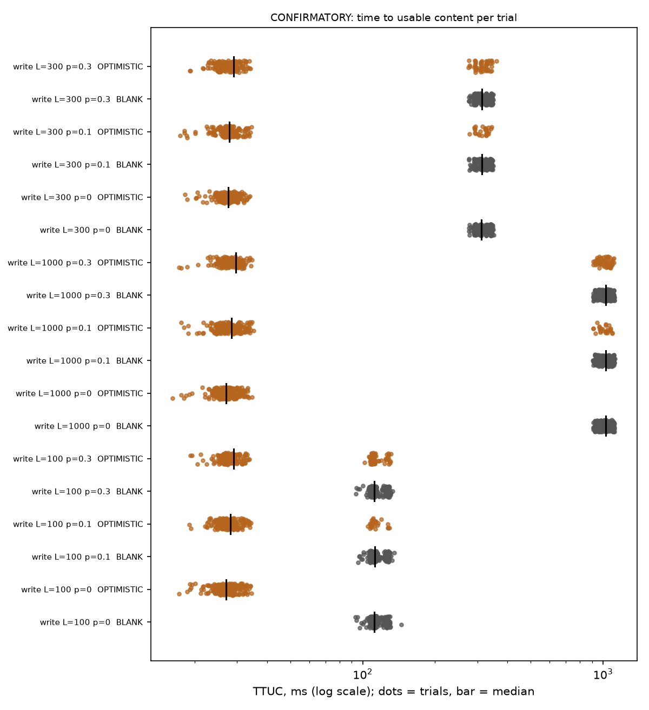
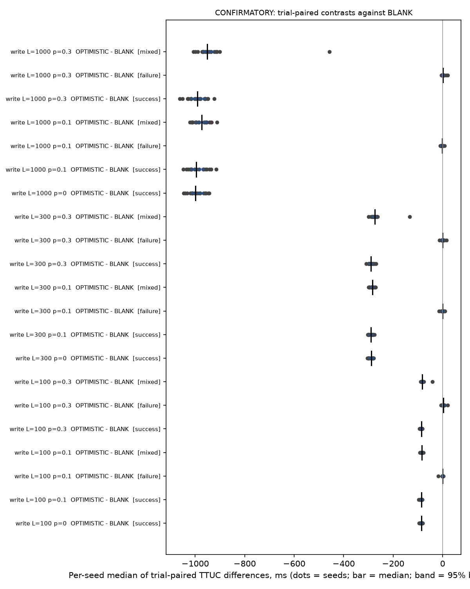
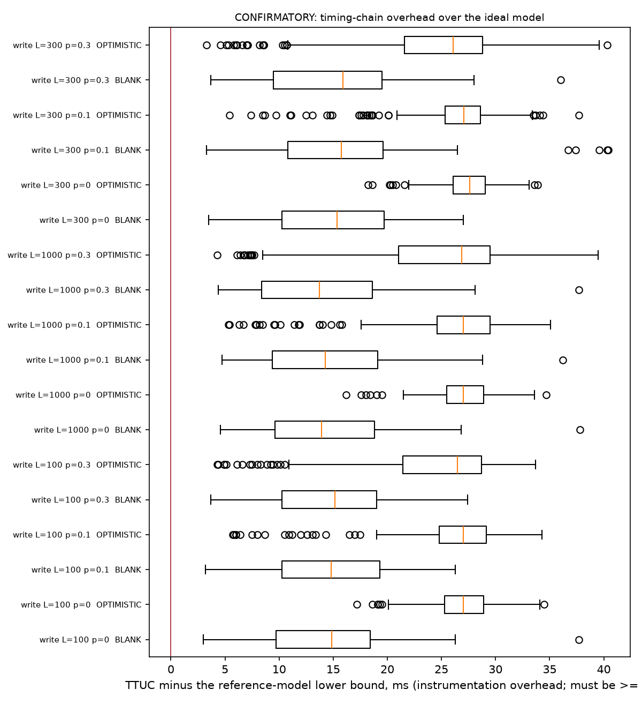

<!-- SPDX-License-Identifier: LicenseRef-SCROLL-NC-Research-1.0 -->
# CONFIRMATORY run report: EXP-003-20261125T080838Z

Generated by `python -m scroll report` from `results.json` (SHA-256 `9bf70c80b0066dcba545dee718b13e886c3fd850fa9d49c9718801db2f474fe6`). Every number below is computed from that file.

## Run

| Experiment | Config hash (prefix) | Code revision | Browser | Runtime (s) | Load avg start | Load avg end | Peak RSS Python (MiB) |
|---|---|---|---|---|---|---|---|
| EXP-003 | 11ad05387d0a71c8 | b5a72c3220 | chrome 158.0.8127.38 headless=True cpu=1x | 6318.7 | [2.36, 1.77, 1.74] | [1.45, 1.44, 1.52] | 78.3 |

Platform: Apple M1 Pro, 10 logical CPUs, Darwin 15.3.1. Other processes (including other agents) were running during the run, so wall-clock and timing values are noisy.

## Cell summaries (trial level, descriptive)

| Cell | Arm | Trials ok | Excl. | Seeds | TTUC median (ms) | Q1 | Q3 | SD of seed medians | TTFF median | Excess min | Excess median |
|---|---|---|---|---|---|---|---|---|---|---|---|
| write L=100 p=0 | BLANK | 200 | 0 | 20 | 111.7 | 109.9 | 121.8 | 3.9 | 111.7 | 3.0 | 14.9 |
| write L=100 p=0 | OPTIMISTIC | 200 | 0 | 20 | 27.0 | 25.3 | 28.9 | 1.2 | 27.0 | 17.2 | 27.0 |
| write L=100 p=0.1 | BLANK | 200 | 0 | 20 | 112.3 | 109.5 | 123.5 | 5.1 | 112.3 | 3.2 | 14.8 |
| write L=100 p=0.1 | OPTIMISTIC | 200 | 0 | 20 | 28.2 | 26.1 | 31.2 | 1.4 | 27.5 | 5.7 | 27.0 |
| write L=100 p=0.3 | BLANK | 200 | 0 | 20 | 111.6 | 109.4 | 123.3 | 2.3 | 111.6 | 3.7 | 15.1 |
| write L=100 p=0.3 | OPTIMISTIC | 200 | 0 | 20 | 29.0 | 26.7 | 108.0 | 9.1 | 27.4 | 4.3 | 26.5 |
| write L=300 p=0 | BLANK | 200 | 0 | 20 | 312.1 | 298.2 | 328.2 | 9.1 | 312.1 | 3.5 | 15.4 |
| write L=300 p=0 | OPTIMISTIC | 200 | 0 | 20 | 27.6 | 26.1 | 29.0 | 0.9 | 27.6 | 18.2 | 27.6 |
| write L=300 p=0.1 | BLANK | 200 | 0 | 20 | 312.9 | 299.4 | 328.3 | 8.7 | 312.9 | 3.3 | 15.8 |
| write L=300 p=0.1 | OPTIMISTIC | 200 | 0 | 20 | 27.8 | 26.4 | 30.2 | 0.8 | 27.3 | 5.4 | 27.0 |
| write L=300 p=0.3 | BLANK | 200 | 0 | 20 | 313.1 | 297.0 | 328.7 | 10.4 | 313.1 | 3.7 | 15.9 |
| write L=300 p=0.3 | OPTIMISTIC | 200 | 0 | 20 | 29.1 | 26.3 | 293.1 | 28.5 | 27.5 | 3.3 | 26.1 |
| write L=1000 p=0 | BLANK | 200 | 0 | 20 | 1024.5 | 966.2 | 1061.1 | 30.7 | 1024.5 | 4.6 | 13.9 |
| write L=1000 p=0 | OPTIMISTIC | 200 | 0 | 20 | 27.0 | 25.5 | 28.9 | 1.0 | 27.0 | 16.2 | 27.0 |
| write L=1000 p=0.1 | BLANK | 200 | 0 | 20 | 1024.4 | 963.6 | 1061.3 | 34.1 | 1024.4 | 4.7 | 14.2 |
| write L=1000 p=0.1 | OPTIMISTIC | 200 | 0 | 20 | 28.5 | 26.0 | 31.1 | 1.6 | 27.5 | 5.3 | 27.0 |
| write L=1000 p=0.3 | BLANK | 200 | 0 | 20 | 1024.8 | 964.6 | 1060.1 | 32.3 | 1024.8 | 4.4 | 13.7 |
| write L=1000 p=0.3 | OPTIMISTIC | 200 | 0 | 20 | 29.7 | 27.0 | 943.7 | 98.6 | 28.0 | 4.3 | 26.9 |

| Cell | Arm | Element - rAF2 (ms) | Event <16 ms share (descriptive) | Input to handler (ms) | Hover-lead excl. | Shift all (median) | Shift CLS-eligible (median) | Wrong-state (ms) | False-state (ms) | Failures | Final correct | Prefetch hit | Defects |
|---|---|---|---|---|---|---|---|---|---|---|---|---|---|
| write L=100 p=0 | BLANK | n/a | 0.695 | 0.250 | 0 | 0.000 | 0.000 | 111.700 | 0.000 | 0 | 1.000 | n/a | 0 |
| write L=100 p=0 | OPTIMISTIC | n/a | 0.365 | 0.300 | 0 | 0.000 | 0.000 | 27.000 | 0.000 | 0 | 1.000 | n/a | 0 |
| write L=100 p=0.1 | BLANK | n/a | 0.625 | 0.200 | 0 | 0.000 | 0.000 | 111.650 | 0.000 | 26 | 1.000 | n/a | 0 |
| write L=100 p=0.1 | OPTIMISTIC | n/a | 0.300 | 0.300 | 0 | 0.000 | 0.000 | 28.200 | 0.000 | 26 | 1.000 | n/a | 0 |
| write L=100 p=0.3 | BLANK | n/a | 0.730 | 0.300 | 0 | 0.000 | 0.000 | 110.150 | 0.000 | 57 | 1.000 | n/a | 0 |
| write L=100 p=0.3 | OPTIMISTIC | n/a | 0.295 | 0.300 | 0 | 0.000 | 0.000 | 29.050 | 0.000 | 57 | 1.000 | n/a | 0 |
| write L=300 p=0 | BLANK | n/a | 0.755 | 0.300 | 0 | 0.000 | 0.000 | 312.050 | 0.000 | 0 | 1.000 | n/a | 0 |
| write L=300 p=0 | OPTIMISTIC | n/a | 0.290 | 0.300 | 0 | 0.000 | 0.000 | 27.600 | 0.000 | 0 | 1.000 | n/a | 0 |
| write L=300 p=0.1 | BLANK | n/a | 0.700 | 0.300 | 0 | 0.000 | 0.000 | 310.950 | 0.000 | 26 | 1.000 | n/a | 0 |
| write L=300 p=0.1 | OPTIMISTIC | n/a | 0.290 | 0.300 | 0 | 0.000 | 0.000 | 27.800 | 0.000 | 26 | 1.000 | n/a | 0 |
| write L=300 p=0.3 | BLANK | n/a | 0.685 | 0.300 | 0 | 0.000 | 0.000 | 303.550 | 0.000 | 57 | 1.000 | n/a | 0 |
| write L=300 p=0.3 | OPTIMISTIC | n/a | 0.305 | 0.300 | 0 | 0.000 | 0.000 | 29.100 | 0.000 | 57 | 1.000 | n/a | 0 |
| write L=1000 p=0 | BLANK | n/a | 0.730 | 0.300 | 0 | 0.000 | 0.000 | 1024.500 | 0.000 | 0 | 1.000 | n/a | 0 |
| write L=1000 p=0 | OPTIMISTIC | n/a | 0.315 | 0.300 | 0 | 0.000 | 0.000 | 27.000 | 0.000 | 0 | 1.000 | n/a | 0 |
| write L=1000 p=0.1 | BLANK | n/a | 0.695 | 0.300 | 0 | 0.000 | 0.000 | 998.000 | 0.000 | 26 | 1.000 | n/a | 0 |
| write L=1000 p=0.1 | OPTIMISTIC | n/a | 0.265 | 0.300 | 0 | 0.000 | 0.000 | 28.500 | 0.000 | 26 | 1.000 | n/a | 0 |
| write L=1000 p=0.3 | BLANK | n/a | 0.675 | 0.300 | 0 | 0.000 | 0.000 | 976.950 | 0.000 | 57 | 1.000 | n/a | 0 |
| write L=1000 p=0.3 | OPTIMISTIC | n/a | 0.250 | 0.300 | 0 | 0.000 | 0.000 | 29.700 | 0.000 | 57 | 1.000 | n/a | 0 |

## Primary estimand: trial-paired contrasts (amendments A1 and A2)

Unit: the seed. Within a seed and cell, interaction k of an arm is paired with interaction k of BLANK (same scheduled delay and outcome); the seed contributes the median of its paired differences. Write cells with p > 0 are split by outcome (success, failure; primary) and also shown mixed (secondary). Intervals are 95% percentile bootstrap over seeds (10,000 resamples, seed 20261124).

| Cell | Contrast | Stratum | Role | Seeds | Trial pairs | Median diff (ms) | CI low | CI high | sigma_d (ms) | n req. |
|---|---|---|---|---|---|---|---|---|---|---|
| write L=100 p=0 | OPTIMISTIC - BLANK | success | primary | 20 | 200 | -85.2 | -88.0 | -84.3 | 3.8 | 1 |
| write L=100 p=0.1 | OPTIMISTIC - BLANK | success | primary | 20 | 174 | -85.3 | -86.6 | -84.8 | 3.5 | 1 |
| write L=100 p=0.1 | OPTIMISTIC - BLANK | failure | primary | 12 | 26 | 0.5 | -1.5 | 1.7 | 5.6 | 1 |
| write L=100 p=0.1 | OPTIMISTIC - BLANK | mixed | secondary | 20 | 200 | -84.0 | -85.3 | -82.6 | 3.3 | 1 |
| write L=100 p=0.3 | OPTIMISTIC - BLANK | success | primary | 20 | 143 | -85.3 | -88.0 | -83.9 | 3.4 | 1 |
| write L=100 p=0.3 | OPTIMISTIC - BLANK | failure | primary | 18 | 57 | 2.7 | -1.0 | 5.4 | 5.9 | 1 |
| write L=100 p=0.3 | OPTIMISTIC - BLANK | mixed | secondary | 20 | 200 | -81.8 | -84.2 | -81.1 | 9.7 | 3 |
| write L=300 p=0 | OPTIMISTIC - BLANK | success | primary | 20 | 200 | -288.5 | -297.7 | -282.3 | 9.0 | 3 |
| write L=300 p=0.1 | OPTIMISTIC - BLANK | success | primary | 20 | 174 | -289.3 | -297.6 | -283.5 | 8.4 | 2 |
| write L=300 p=0.1 | OPTIMISTIC - BLANK | failure | primary | 12 | 26 | -0.8 | -3.0 | 4.3 | 6.7 | 2 |
| write L=300 p=0.1 | OPTIMISTIC - BLANK | mixed | secondary | 20 | 200 | -283.8 | -288.9 | -281.5 | 8.5 | 2 |
| write L=300 p=0.3 | OPTIMISTIC - BLANK | success | primary | 20 | 143 | -290.4 | -297.4 | -284.1 | 10.2 | 3 |
| write L=300 p=0.3 | OPTIMISTIC - BLANK | failure | primary | 18 | 57 | -0.1 | -2.6 | 1.5 | 5.9 | 1 |
| write L=300 p=0.3 | OPTIMISTIC - BLANK | mixed | secondary | 20 | 200 | -274.6 | -281.3 | -270.9 | 33.5 | 31 |
| write L=1000 p=0 | OPTIMISTIC - BLANK | success | primary | 20 | 200 | -998.6 | -1012.2 | -972.6 | 31.1 | 27 |
| write L=1000 p=0.1 | OPTIMISTIC - BLANK | success | primary | 20 | 174 | -995.9 | -1015.8 | -967.3 | 35.9 | 35 |
| write L=1000 p=0.1 | OPTIMISTIC - BLANK | failure | primary | 12 | 26 | -1.6 | -7.1 | 0.1 | 4.9 | 1 |
| write L=1000 p=0.1 | OPTIMISTIC - BLANK | mixed | secondary | 20 | 200 | -974.1 | -998.1 | -956.4 | 31.8 | 28 |
| write L=1000 p=0.3 | OPTIMISTIC - BLANK | success | primary | 20 | 143 | -990.7 | -1016.6 | -961.7 | 37.0 | 38 |
| write L=1000 p=0.3 | OPTIMISTIC - BLANK | failure | primary | 18 | 57 | 0.6 | -1.4 | 3.4 | 6.2 | 2 |
| write L=1000 p=0.3 | OPTIMISTIC - BLANK | mixed | secondary | 20 | 200 | -951.5 | -967.8 | -929.2 | 114.2 | 355 |

## Secondary: draft seed-median estimand (descriptive)

Each seed contributes the median TTUC of its session; differences are arm minus BLANK for the same seed and cell. Intervals are 95% percentile bootstrap over seeds (10,000 resamples, seed 20261124). `n req.` is the protocol 5.1 formula with delta = 17 ms, alpha 0.05, power 0.80.

| Cell | Contrast | Pairs | Median diff (ms) | CI low | CI high | sigma_d (ms) | sigma_d CI high | n req. | n req. (CI high) | Median diff, rAF1 | Median diff, Element |
|---|---|---|---|---|---|---|---|---|---|---|---|
| write L=100 p=0 | OPTIMISTIC - BLANK | 20 | -84.6 | -87.5 | -83.3 | 4.4 | 5.9 | 1 | 1 | -84.4 | n/a |
| write L=100 p=0.1 | OPTIMISTIC - BLANK | 20 | -84.3 | -86.6 | -83.3 | 4.9 | 6.0 | 1 | 1 | -84.1 | n/a |
| write L=100 p=0.3 | OPTIMISTIC - BLANK | 20 | -82.1 | -83.6 | -81.3 | 9.8 | 15.9 | 3 | 7 | -81.9 | n/a |
| write L=300 p=0 | OPTIMISTIC - BLANK | 20 | -289.0 | -297.6 | -281.8 | 9.1 | 10.5 | 3 | 3 | -284.1 | n/a |
| write L=300 p=0.1 | OPTIMISTIC - BLANK | 20 | -287.8 | -297.9 | -283.0 | 8.5 | 9.6 | 2 | 3 | -287.5 | n/a |
| write L=300 p=0.3 | OPTIMISTIC - BLANK | 20 | -288.7 | -296.2 | -279.7 | 33.2 | 53.6 | 30 | 78 | -285.6 | n/a |
| write L=1000 p=0 | OPTIMISTIC - BLANK | 20 | -996.7 | -1013.1 | -975.3 | 30.7 | 36.4 | 26 | 37 | -997.5 | n/a |
| write L=1000 p=0.1 | OPTIMISTIC - BLANK | 20 | -992.1 | -1014.5 | -973.0 | 34.1 | 40.3 | 32 | 45 | -993.3 | n/a |
| write L=1000 p=0.3 | OPTIMISTIC - BLANK | 20 | -992.5 | -1011.6 | -968.6 | 114.6 | 186.1 | 357 | 941 | -993.2 | n/a |

## Degenerate cases and warnings

- write L=100 p=0 BLANK: Event Timing duration below the 16 ms threshold in 70% of trials (metric mostly unobservable; descriptive only, amendment A4).
- write L=100 p=0.1 BLANK: Event Timing duration below the 16 ms threshold in 62% of trials (metric mostly unobservable; descriptive only, amendment A4).
- write L=100 p=0.3 BLANK: Event Timing duration below the 16 ms threshold in 73% of trials (metric mostly unobservable; descriptive only, amendment A4).
- write L=300 p=0 BLANK: Event Timing duration below the 16 ms threshold in 76% of trials (metric mostly unobservable; descriptive only, amendment A4).
- write L=300 p=0.1 BLANK: Event Timing duration below the 16 ms threshold in 70% of trials (metric mostly unobservable; descriptive only, amendment A4).
- write L=300 p=0.3 BLANK: Event Timing duration below the 16 ms threshold in 68% of trials (metric mostly unobservable; descriptive only, amendment A4).
- write L=1000 p=0 BLANK: Event Timing duration below the 16 ms threshold in 73% of trials (metric mostly unobservable; descriptive only, amendment A4).
- write L=1000 p=0.1 BLANK: Event Timing duration below the 16 ms threshold in 70% of trials (metric mostly unobservable; descriptive only, amendment A4).
- write L=1000 p=0.3 BLANK: Event Timing duration below the 16 ms threshold in 68% of trials (metric mostly unobservable; descriptive only, amendment A4).
- write L=100 p=0.1 BLANK: failures per session [2, 3, 2, 0, 3, 2, 2, 0, 3, 0, 2, 2, 0, 1, 1, 0, 3, 0, 0, 0] of K=10; the per-seed median TTUC reflects only successes in some seeds.
- write L=100 p=0.1 OPTIMISTIC: failures per session [2, 3, 2, 0, 3, 2, 2, 0, 3, 0, 2, 2, 0, 1, 1, 0, 3, 0, 0, 0] of K=10; the per-seed median TTUC reflects only successes in some seeds.
- write L=100 p=0.3 BLANK: failures per session [4, 4, 2, 3, 4, 3, 3, 0, 4, 1, 2, 3, 4, 5, 4, 2, 4, 0, 1, 4] of K=10; the per-seed median TTUC reflects only successes in some seeds.
- write L=100 p=0.3 OPTIMISTIC: failures per session [4, 4, 2, 3, 4, 3, 3, 0, 4, 1, 2, 3, 4, 5, 4, 2, 4, 0, 1, 4] of K=10; the per-seed median TTUC reflects only successes in some seeds.
- write L=300 p=0.1 BLANK: failures per session [2, 3, 2, 0, 3, 2, 2, 0, 3, 0, 2, 2, 0, 1, 1, 0, 3, 0, 0, 0] of K=10; the per-seed median TTUC reflects only successes in some seeds.
- write L=300 p=0.1 OPTIMISTIC: failures per session [2, 3, 2, 0, 3, 2, 2, 0, 3, 0, 2, 2, 0, 1, 1, 0, 3, 0, 0, 0] of K=10; the per-seed median TTUC reflects only successes in some seeds.
- write L=300 p=0.3 BLANK: failures per session [4, 4, 2, 3, 4, 3, 3, 0, 4, 1, 2, 3, 4, 5, 4, 2, 4, 0, 1, 4] of K=10; the per-seed median TTUC reflects only successes in some seeds.
- write L=300 p=0.3 OPTIMISTIC: failures per session [4, 4, 2, 3, 4, 3, 3, 0, 4, 1, 2, 3, 4, 5, 4, 2, 4, 0, 1, 4] of K=10; the per-seed median TTUC reflects only successes in some seeds.
- write L=1000 p=0.1 BLANK: failures per session [2, 3, 2, 0, 3, 2, 2, 0, 3, 0, 2, 2, 0, 1, 1, 0, 3, 0, 0, 0] of K=10; the per-seed median TTUC reflects only successes in some seeds.
- write L=1000 p=0.1 OPTIMISTIC: failures per session [2, 3, 2, 0, 3, 2, 2, 0, 3, 0, 2, 2, 0, 1, 1, 0, 3, 0, 0, 0] of K=10; the per-seed median TTUC reflects only successes in some seeds.
- write L=1000 p=0.3 BLANK: failures per session [4, 4, 2, 3, 4, 3, 3, 0, 4, 1, 2, 3, 4, 5, 4, 2, 4, 0, 1, 4] of K=10; the per-seed median TTUC reflects only successes in some seeds.
- write L=1000 p=0.3 OPTIMISTIC: failures per session [4, 4, 2, 3, 4, 3, 3, 0, 4, 1, 2, 3, 4, 5, 4, 2, 4, 0, 1, 4] of K=10; the per-seed median TTUC reflects only successes in some seeds.

## Runtime and projection

Fitted on this run: per-trial overhead median 0.069 s (90th percentile 0.104 s) beyond delay + settle + pre-input + hover lead; per-session overhead median 0.145 s; median session wall 15.87 s; median trial wall 1.570 s. Projections use the nominal latency as the delay and do not model CPU throttling or headed-mode cost.

| Experiment | Config | Sessions | Interactions | Projected (min) |
|---|---|---|---|---|
| EXP-002 | EXP-002 read path (frozen v1.0, owner-approved 2026-11-24). | 240 | 2400 | 65.8 |
| EXP-003 | EXP-003 write path (frozen v1.0, owner-approved 2026-11-24). | 360 | 3600 | 105.0 |
| EXP-004 | EXP-004 sensitivity S2, CPU throttle 4x (frozen v1.0, owner-approved 2026-11-24). | 140 | 1400 | 45.1 |
| EXP-004 | EXP-004 sensitivity S3, prefetch lead time (frozen v1.0, owner-approved 2026-11-24; S1 reuses EXP-002/003 data; S2 and S4 are browser-setting variants). | 80 | 800 | 27.8 |
| EXP-004 | EXP-004 sensitivity S4, headed browser (frozen v1.0, owner-approved 2026-11-24). | 140 | 1400 | 45.1 |

## Figures

**FIG-E1.** Time to usable content (TTUC, ms, log scale) for every analysed trial, by cell and arm. Vertical bars mark medians. Exploratory pre-freeze run; trials within a session are not independent.

**FIG-E2.** Trial-paired TTUC differences (arm minus BLANK, ms): each dot is one seed's median over its paired interactions (write cells with p > 0 split by outcome), with the median over seeds and a 95% percentile bootstrap interval over seeds.

**FIG-E3.** TTUC minus the reference-model lower bound (ms) per cell and arm; boxes show quartiles over trials. Negative values would indicate an instrumentation defect.

## Files

- `../results.json` (validated against `src/scroll/schemas/result-1.0.0.json`)
- `metrics.csv`, `cell_summary.csv`, `trial_paired_contrasts.csv`, `paired_contrasts.csv`, `runtime_projection.csv`
- `figures/`

Report generated 2026-11-25T09:54:18Z.
