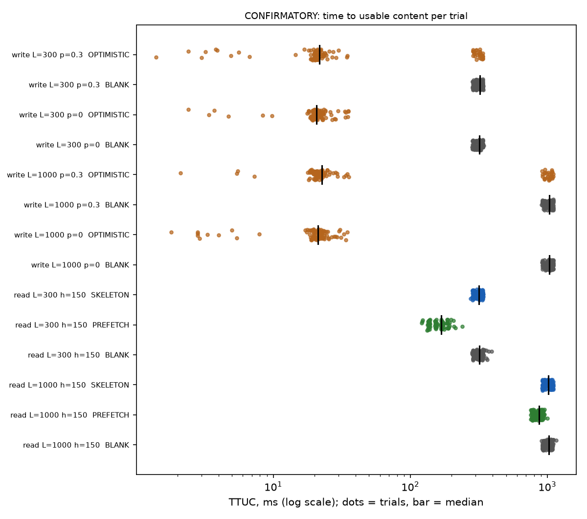
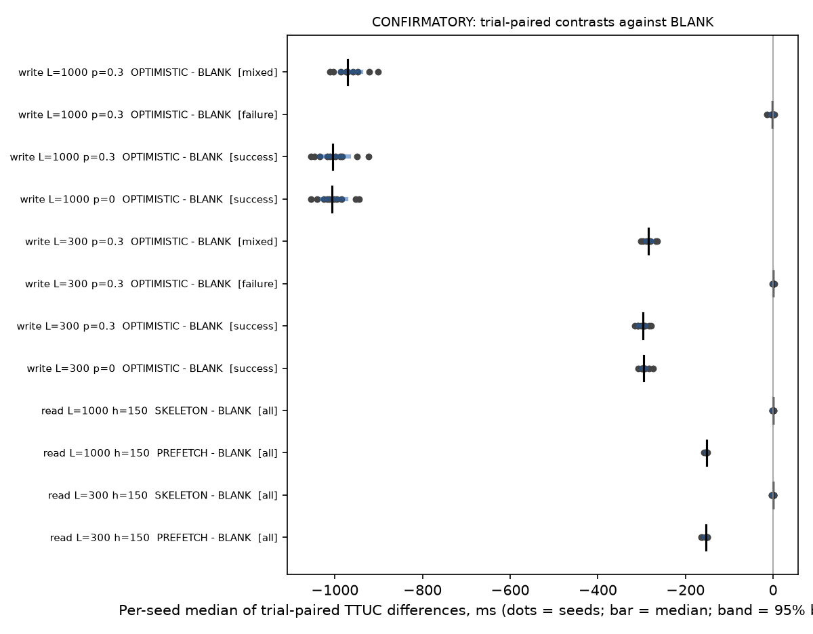
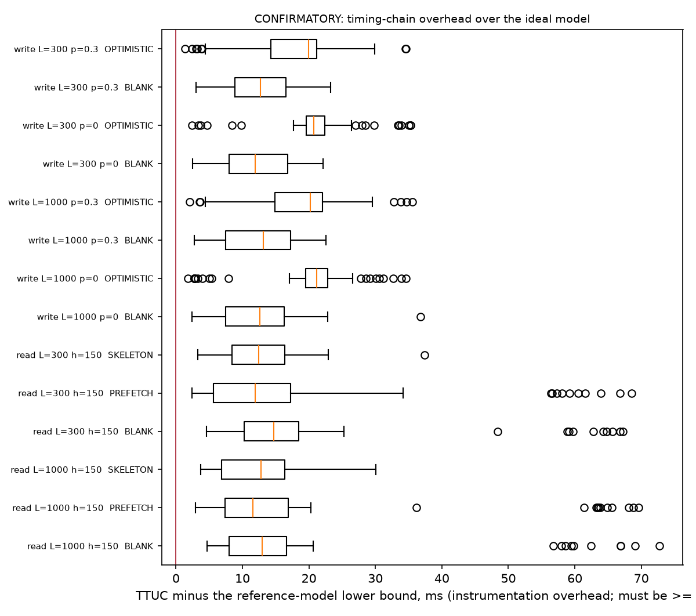

<!-- SPDX-License-Identifier: LicenseRef-SCROLL-NC-Research-1.0 -->
# CONFIRMATORY run report: EXP-004-20261125T095434Z

Generated by `python -m scroll report` from `results.json` (SHA-256 `173a3b82f003f467dc89859821ff14d1d5061af8c70b4ea37aa63a687d4b81bf`). Every number below is computed from that file.

## Run

| Experiment | Config hash (prefix) | Code revision | Browser | Runtime (s) | Load avg start | Load avg end | Peak RSS Python (MiB) |
|---|---|---|---|---|---|---|---|
| EXP-004 | 200f25f294f699d3 | b5a72c3220 | chrome 158.0.8127.38 headless=True cpu=4x | 2677.9 | [1.37, 1.41, 1.51] | [2.29, 2.12, 1.74] | 63.1 |

Platform: Apple M1 Pro, 10 logical CPUs, Darwin 15.3.1. Other processes (including other agents) were running during the run, so wall-clock and timing values are noisy.

## Cell summaries (trial level, descriptive)

| Cell | Arm | Trials ok | Excl. | Seeds | TTUC median (ms) | Q1 | Q3 | SD of seed medians | TTFF median | Excess min | Excess median |
|---|---|---|---|---|---|---|---|---|---|---|---|
| read L=300 h=150 | BLANK | 100 | 0 | 10 | 319.6 | 302.1 | 335.8 | 11.3 | 319.6 | 4.6 | 14.7 |
| read L=300 h=150 | PREFETCH | 100 | 0 | 10 | 168.4 | 138.0 | 171.9 | 12.7 | 168.4 | 2.4 | 11.9 |
| read L=300 h=150 | SKELETON | 100 | 0 | 10 | 317.8 | 291.8 | 323.0 | 9.2 | 21.4 | 3.3 | 12.4 |
| read L=1000 h=150 | BLANK | 100 | 0 | 10 | 1022.9 | 954.4 | 1069.8 | 38.0 | 1022.9 | 4.7 | 13.0 |
| read L=1000 h=150 | PREFETCH | 100 | 0 | 10 | 870.0 | 804.7 | 917.4 | 40.9 | 870.0 | 2.9 | 11.6 |
| read L=1000 h=150 | SKELETON | 100 | 0 | 10 | 1021.0 | 952.6 | 1066.3 | 36.5 | 20.5 | 3.7 | 12.8 |
| write L=300 p=0 | BLANK | 100 | 0 | 10 | 320.1 | 302.3 | 334.2 | 10.0 | 320.1 | 2.5 | 12.0 |
| write L=300 p=0 | OPTIMISTIC | 100 | 0 | 10 | 20.8 | 19.6 | 22.4 | 0.5 | 20.8 | 2.4 | 20.8 |
| write L=300 p=0.3 | BLANK | 100 | 0 | 10 | 321.1 | 302.0 | 335.3 | 11.5 | 321.1 | 3.0 | 12.7 |
| write L=300 p=0.3 | OPTIMISTIC | 100 | 0 | 10 | 21.7 | 20.1 | 287.3 | 1.9 | 20.4 | 1.4 | 20.0 |
| write L=1000 p=0 | BLANK | 100 | 0 | 10 | 1034.4 | 961.7 | 1074.2 | 35.0 | 1034.4 | 2.4 | 12.6 |
| write L=1000 p=0 | OPTIMISTIC | 100 | 0 | 10 | 21.2 | 19.5 | 22.8 | 1.0 | 21.2 | 1.8 | 21.2 |
| write L=1000 p=0.3 | BLANK | 100 | 0 | 10 | 1035.4 | 969.0 | 1075.6 | 35.0 | 1035.4 | 2.8 | 13.1 |
| write L=1000 p=0.3 | OPTIMISTIC | 100 | 0 | 10 | 22.7 | 20.4 | 929.0 | 4.1 | 21.4 | 2.1 | 20.2 |

| Cell | Arm | Element - rAF2 (ms) | Event <16 ms share (descriptive) | Input to handler (ms) | Hover-lead excl. | Shift all (median) | Shift CLS-eligible (median) | Wrong-state (ms) | False-state (ms) | Failures | Final correct | Prefetch hit | Defects |
|---|---|---|---|---|---|---|---|---|---|---|---|---|---|
| read L=300 h=150 | BLANK | -5.950 | 0.930 | 0.500 | 0 | 0.035 | 0.000 | n/a | n/a | 0 | 1.000 | n/a | 0 |
| read L=300 h=150 | PREFETCH | -4.050 | 0.950 | 0.500 | 0 | 0.035 | 0.000 | n/a | n/a | 0 | 1.000 | 1.000 | 0 |
| read L=300 h=150 | SKELETON | -2.800 | 0.810 | 0.500 | 0 | 0.035 | 0.000 | n/a | n/a | 0 | 1.000 | n/a | 0 |
| read L=1000 h=150 | BLANK | -1.800 | 0.960 | 0.500 | 0 | 0.035 | 0.035 | n/a | n/a | 0 | 1.000 | n/a | 0 |
| read L=1000 h=150 | PREFETCH | -2.000 | 0.910 | 0.500 | 0 | 0.035 | 0.035 | n/a | n/a | 0 | 1.000 | 1.000 | 0 |
| read L=1000 h=150 | SKELETON | -2.600 | 0.840 | 0.500 | 0 | 0.035 | 0.000 | n/a | n/a | 0 | 1.000 | n/a | 0 |
| write L=300 p=0 | BLANK | n/a | 0.940 | 0.500 | 0 | 0.000 | 0.000 | 320.100 | 0.000 | 0 | 1.000 | n/a | 0 |
| write L=300 p=0 | OPTIMISTIC | n/a | 0.890 | 0.500 | 0 | 0.000 | 0.000 | 20.750 | 0.000 | 0 | 1.000 | n/a | 0 |
| write L=300 p=0.3 | BLANK | n/a | 0.970 | 0.600 | 0 | 0.000 | 0.000 | 303.350 | 0.000 | 28 | 1.000 | n/a | 0 |
| write L=300 p=0.3 | OPTIMISTIC | n/a | 0.920 | 0.500 | 0 | 0.000 | 0.000 | 21.700 | 0.000 | 28 | 1.000 | n/a | 0 |
| write L=1000 p=0 | BLANK | n/a | 0.940 | 0.500 | 0 | 0.000 | 0.000 | 1034.450 | 0.000 | 0 | 1.000 | n/a | 0 |
| write L=1000 p=0 | OPTIMISTIC | n/a | 0.920 | 0.500 | 0 | 0.000 | 0.000 | 21.200 | 0.000 | 0 | 1.000 | n/a | 0 |
| write L=1000 p=0.3 | BLANK | n/a | 0.930 | 0.500 | 0 | 0.000 | 0.000 | 986.250 | 0.000 | 28 | 1.000 | n/a | 0 |
| write L=1000 p=0.3 | OPTIMISTIC | n/a | 0.890 | 0.500 | 0 | 0.000 | 0.000 | 22.650 | 0.000 | 28 | 1.000 | n/a | 0 |

## Primary estimand: trial-paired contrasts (amendments A1 and A2)

Unit: the seed. Within a seed and cell, interaction k of an arm is paired with interaction k of BLANK (same scheduled delay and outcome); the seed contributes the median of its paired differences. Write cells with p > 0 are split by outcome (success, failure; primary) and also shown mixed (secondary). Intervals are 95% percentile bootstrap over seeds (10,000 resamples, seed 20261124).

| Cell | Contrast | Stratum | Role | Seeds | Trial pairs | Median diff (ms) | CI low | CI high | sigma_d (ms) | n req. |
|---|---|---|---|---|---|---|---|---|---|---|
| read L=300 h=150 | PREFETCH - BLANK | all | primary | 10 | 100 | -152.9 | -158.0 | -151.2 | 4.9 | 1 |
| read L=300 h=150 | SKELETON - BLANK | all | primary | 10 | 100 | -0.5 | -2.3 | 1.0 | 1.9 | 1 |
| read L=1000 h=150 | PREFETCH - BLANK | all | primary | 10 | 100 | -151.9 | -153.1 | -151.4 | 2.0 | 1 |
| read L=1000 h=150 | SKELETON - BLANK | all | primary | 10 | 100 | -0.4 | -1.3 | 0.5 | 1.0 | 1 |
| write L=300 p=0 | OPTIMISTIC - BLANK | success | primary | 10 | 100 | -295.7 | -299.3 | -288.8 | 9.5 | 3 |
| write L=300 p=0.3 | OPTIMISTIC - BLANK | success | primary | 10 | 72 | -296.3 | -307.4 | -289.2 | 11.2 | 4 |
| write L=300 p=0.3 | OPTIMISTIC - BLANK | failure | primary | 9 | 28 | -0.3 | -0.9 | 2.0 | 1.5 | 1 |
| write L=300 p=0.3 | OPTIMISTIC - BLANK | mixed | secondary | 10 | 100 | -283.9 | -290.5 | -275.2 | 11.4 | 4 |
| write L=1000 p=0 | OPTIMISTIC - BLANK | success | primary | 10 | 100 | -1007.2 | -1029.1 | -974.2 | 35.2 | 34 |
| write L=1000 p=0.3 | OPTIMISTIC - BLANK | success | primary | 10 | 72 | -1004.4 | -1034.2 | -968.7 | 41.8 | 48 |
| write L=1000 p=0.3 | OPTIMISTIC - BLANK | failure | primary | 9 | 28 | -1.3 | -4.2 | 0.9 | 4.8 | 1 |
| write L=1000 p=0.3 | OPTIMISTIC - BLANK | mixed | secondary | 10 | 100 | -971.8 | -988.6 | -939.9 | 34.0 | 32 |

## Secondary: draft seed-median estimand (descriptive)

Each seed contributes the median TTUC of its session; differences are arm minus BLANK for the same seed and cell. Intervals are 95% percentile bootstrap over seeds (10,000 resamples, seed 20261124). `n req.` is the protocol 5.1 formula with delta = 17 ms, alpha 0.05, power 0.80.

| Cell | Contrast | Pairs | Median diff (ms) | CI low | CI high | sigma_d (ms) | sigma_d CI high | n req. | n req. (CI high) | Median diff, rAF1 | Median diff, Element |
|---|---|---|---|---|---|---|---|---|---|---|---|
| read L=300 h=150 | PREFETCH - BLANK | 10 | -154.2 | -159.9 | -150.9 | 5.2 | 6.1 | 1 | 2 | -152.9 | -155.8 |
| read L=300 h=150 | SKELETON - BLANK | 10 | -2.1 | -5.5 | -0.4 | 5.0 | 6.8 | 1 | 2 | 0.4 | 0.2 |
| read L=1000 h=150 | PREFETCH - BLANK | 10 | -155.4 | -159.2 | -151.2 | 4.8 | 5.9 | 1 | 1 | -153.3 | -155.5 |
| read L=1000 h=150 | SKELETON - BLANK | 10 | -4.3 | -15.8 | 0.7 | 9.2 | 11.7 | 3 | 4 | -0.1 | -1.5 |
| write L=300 p=0 | OPTIMISTIC - BLANK | 10 | -299.3 | -301.7 | -288.0 | 9.8 | 13.0 | 3 | 5 | -296.4 | n/a |
| write L=300 p=0.3 | OPTIMISTIC - BLANK | 10 | -298.0 | -303.5 | -284.1 | 11.6 | 14.5 | 4 | 6 | -298.0 | n/a |
| write L=1000 p=0 | OPTIMISTIC - BLANK | 10 | -1008.4 | -1032.3 | -975.4 | 35.2 | 44.2 | 34 | 54 | -1008.8 | n/a |
| write L=1000 p=0.3 | OPTIMISTIC - BLANK | 10 | -1011.1 | -1034.1 | -973.0 | 37.8 | 47.7 | 39 | 62 | -1010.5 | n/a |

## Degenerate cases and warnings

- read L=300 h=150 BLANK: Event Timing duration below the 16 ms threshold in 93% of trials (metric mostly unobservable; descriptive only, amendment A4).
- read L=300 h=150 PREFETCH: Event Timing duration below the 16 ms threshold in 95% of trials (metric mostly unobservable; descriptive only, amendment A4).
- read L=300 h=150 SKELETON: Event Timing duration below the 16 ms threshold in 81% of trials (metric mostly unobservable; descriptive only, amendment A4).
- read L=1000 h=150 BLANK: Event Timing duration below the 16 ms threshold in 96% of trials (metric mostly unobservable; descriptive only, amendment A4).
- read L=1000 h=150 PREFETCH: Event Timing duration below the 16 ms threshold in 91% of trials (metric mostly unobservable; descriptive only, amendment A4).
- read L=1000 h=150 SKELETON: Event Timing duration below the 16 ms threshold in 84% of trials (metric mostly unobservable; descriptive only, amendment A4).
- write L=300 p=0 BLANK: Event Timing duration below the 16 ms threshold in 94% of trials (metric mostly unobservable; descriptive only, amendment A4).
- write L=300 p=0 OPTIMISTIC: Event Timing duration below the 16 ms threshold in 89% of trials (metric mostly unobservable; descriptive only, amendment A4).
- write L=300 p=0.3 BLANK: Event Timing duration below the 16 ms threshold in 97% of trials (metric mostly unobservable; descriptive only, amendment A4).
- write L=300 p=0.3 OPTIMISTIC: Event Timing duration below the 16 ms threshold in 92% of trials (metric mostly unobservable; descriptive only, amendment A4).
- write L=1000 p=0 BLANK: Event Timing duration below the 16 ms threshold in 94% of trials (metric mostly unobservable; descriptive only, amendment A4).
- write L=1000 p=0 OPTIMISTIC: Event Timing duration below the 16 ms threshold in 92% of trials (metric mostly unobservable; descriptive only, amendment A4).
- write L=1000 p=0.3 BLANK: Event Timing duration below the 16 ms threshold in 93% of trials (metric mostly unobservable; descriptive only, amendment A4).
- write L=1000 p=0.3 OPTIMISTIC: Event Timing duration below the 16 ms threshold in 89% of trials (metric mostly unobservable; descriptive only, amendment A4).
- write L=300 p=0.3 BLANK: failures per session [4, 4, 2, 3, 4, 3, 3, 0, 4, 1] of K=10; the per-seed median TTUC reflects only successes in some seeds.
- write L=300 p=0.3 OPTIMISTIC: failures per session [4, 4, 2, 3, 4, 3, 3, 0, 4, 1] of K=10; the per-seed median TTUC reflects only successes in some seeds.
- write L=1000 p=0.3 BLANK: failures per session [4, 4, 2, 3, 4, 3, 3, 0, 4, 1] of K=10; the per-seed median TTUC reflects only successes in some seeds.
- write L=1000 p=0.3 OPTIMISTIC: failures per session [4, 4, 2, 3, 4, 3, 3, 0, 4, 1] of K=10; the per-seed median TTUC reflects only successes in some seeds.

## Runtime and projection

Fitted on this run: per-trial overhead median 0.054 s (90th percentile 0.068 s) beyond delay + settle + pre-input + hover lead; per-session overhead median 0.187 s; median session wall 18.44 s; median trial wall 1.837 s. Projections use the nominal latency as the delay and do not model CPU throttling or headed-mode cost.

| Experiment | Config | Sessions | Interactions | Projected (min) |
|---|---|---|---|---|
| EXP-002 | EXP-002 read path (frozen v1.0, owner-approved 2026-11-24). | 240 | 2400 | 65.4 |
| EXP-003 | EXP-003 write path (frozen v1.0, owner-approved 2026-11-24). | 360 | 3600 | 104.4 |
| EXP-004 | EXP-004 sensitivity S2, CPU throttle 4x (frozen v1.0, owner-approved 2026-11-24). | 140 | 1400 | 44.9 |
| EXP-004 | EXP-004 sensitivity S3, prefetch lead time (frozen v1.0, owner-approved 2026-11-24; S1 reuses EXP-002/003 data; S2 and S4 are browser-setting variants). | 80 | 800 | 27.6 |
| EXP-004 | EXP-004 sensitivity S4, headed browser (frozen v1.0, owner-approved 2026-11-24). | 140 | 1400 | 44.9 |

## Figures

**FIG-E1.** Time to usable content (TTUC, ms, log scale) for every analysed trial, by cell and arm. Vertical bars mark medians. Exploratory pre-freeze run; trials within a session are not independent.

**FIG-E2.** Trial-paired TTUC differences (arm minus BLANK, ms): each dot is one seed's median over its paired interactions (write cells with p > 0 split by outcome), with the median over seeds and a 95% percentile bootstrap interval over seeds.

**FIG-E3.** TTUC minus the reference-model lower bound (ms) per cell and arm; boxes show quartiles over trials. Negative values would indicate an instrumentation defect.

## Files

- `../results.json` (validated against `src/scroll/schemas/result-1.0.0.json`)
- `metrics.csv`, `cell_summary.csv`, `trial_paired_contrasts.csv`, `paired_contrasts.csv`, `runtime_projection.csv`
- `figures/`

Report generated 2026-11-25T11:50:33Z.
