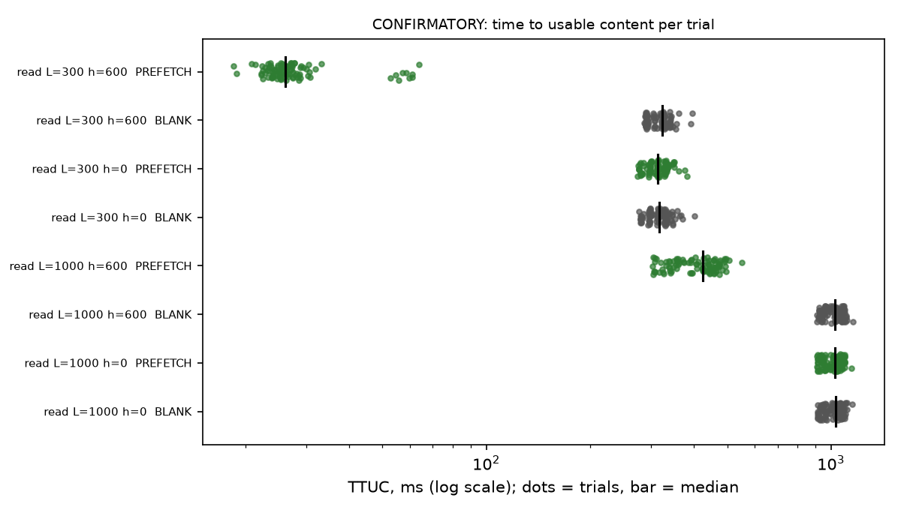
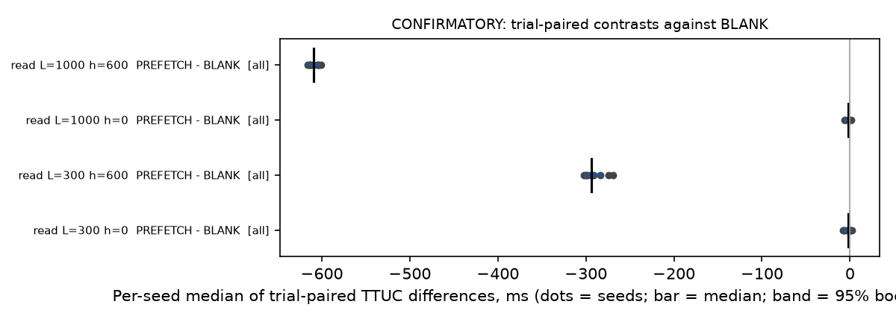
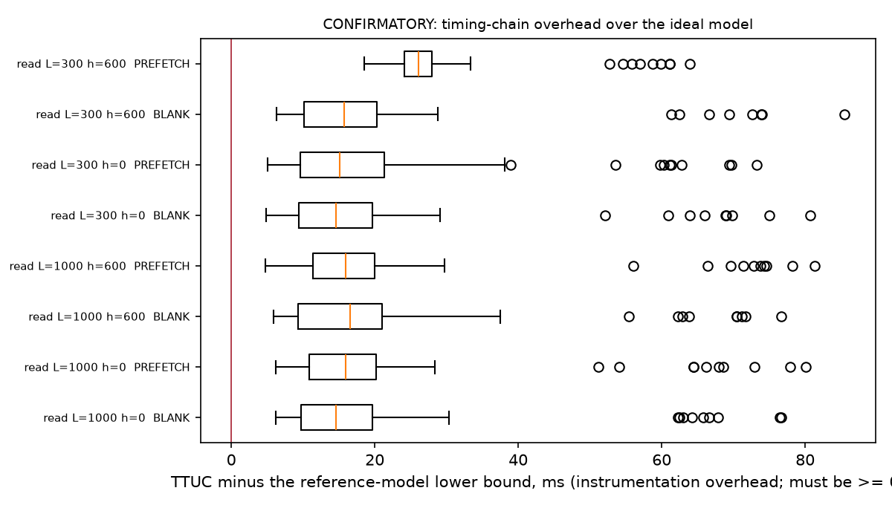

<!-- SPDX-License-Identifier: LicenseRef-SCROLL-NC-Research-1.0 -->
# CONFIRMATORY run report: EXP-004-20261125T103912Z

Generated by `python -m scroll report` from `results.json` (SHA-256 `0e3ea2a6f3d4ae6da95de027b0d3bcf228a3c24600462ea84782387a6576041c`). Every number below is computed from that file.

## Run

| Experiment | Config hash (prefix) | Code revision | Browser | Runtime (s) | Load avg start | Load avg end | Peak RSS Python (MiB) |
|---|---|---|---|---|---|---|---|
| EXP-004 | 5a8b8a7d9e8b4f2c | b5a72c3220 | chrome 158.0.8127.38 headless=True cpu=1x | 1584.4 | [2.29, 2.12, 1.74] | [2.19, 2.42, 2.28] | 61.1 |

Platform: Apple M1 Pro, 10 logical CPUs, Darwin 15.3.1. Other processes (including other agents) were running during the run, so wall-clock and timing values are noisy.

## Cell summaries (trial level, descriptive)

| Cell | Arm | Trials ok | Excl. | Seeds | TTUC median (ms) | Q1 | Q3 | SD of seed medians | TTFF median | Excess min | Excess median |
|---|---|---|---|---|---|---|---|---|---|---|---|
| read L=300 h=0 | BLANK | 99 | 1 | 10 | 317.5 | 298.2 | 331.6 | 13.6 | 317.5 | 4.9 | 14.6 |
| read L=300 h=0 | PREFETCH | 100 | 0 | 10 | 314.6 | 298.4 | 330.7 | 9.6 | 314.6 | 5.1 | 15.1 |
| read L=300 h=600 | BLANK | 99 | 1 | 10 | 323.3 | 293.1 | 328.5 | 12.5 | 323.3 | 6.3 | 15.7 |
| read L=300 h=600 | PREFETCH | 99 | 1 | 10 | 26.1 | 24.1 | 28.0 | 1.2 | 26.1 | 18.5 | 26.1 |
| read L=1000 h=0 | BLANK | 100 | 0 | 10 | 1030.9 | 962.6 | 1066.2 | 37.9 | 1030.9 | 6.2 | 14.6 |
| read L=1000 h=0 | PREFETCH | 100 | 0 | 10 | 1029.0 | 950.3 | 1067.3 | 39.8 | 1029.0 | 6.2 | 16.0 |
| read L=1000 h=600 | BLANK | 99 | 1 | 10 | 1026.9 | 959.2 | 1073.7 | 39.6 | 1026.9 | 5.9 | 16.6 |
| read L=1000 h=600 | PREFETCH | 100 | 0 | 10 | 424.5 | 353.1 | 459.2 | 37.7 | 424.5 | 4.8 | 15.9 |

| Cell | Arm | Element - rAF2 (ms) | Event <16 ms share (descriptive) | Input to handler (ms) | Hover-lead excl. | Shift all (median) | Shift CLS-eligible (median) | Wrong-state (ms) | False-state (ms) | Failures | Final correct | Prefetch hit | Defects |
|---|---|---|---|---|---|---|---|---|---|---|---|---|---|
| read L=300 h=0 | BLANK | -2.100 | 0.162 | 0.200 | 1 | 0.035 | 0.000 | n/a | n/a | 0 | 1.000 | n/a | 0 |
| read L=300 h=0 | PREFETCH | -2.450 | 0.220 | 0.200 | 0 | 0.035 | 0.000 | n/a | n/a | 0 | 1.000 | 1.000 | 0 |
| read L=300 h=600 | BLANK | -2.300 | 0.899 | 0.300 | 1 | 0.035 | 0.000 | n/a | n/a | 0 | 1.000 | n/a | 0 |
| read L=300 h=600 | PREFETCH | -10.400 | 0.323 | 0.300 | 1 | 0.035 | 0.000 | n/a | n/a | 0 | 1.000 | 1.000 | 0 |
| read L=1000 h=0 | BLANK | -1.000 | 0.210 | 0.200 | 0 | 0.035 | 0.035 | n/a | n/a | 0 | 1.000 | n/a | 0 |
| read L=1000 h=0 | PREFETCH | -2.700 | 0.200 | 0.200 | 0 | 0.035 | 0.035 | n/a | n/a | 0 | 1.000 | 1.000 | 0 |
| read L=1000 h=600 | BLANK | -0.700 | 0.828 | 0.300 | 1 | 0.035 | 0.035 | n/a | n/a | 0 | 1.000 | n/a | 0 |
| read L=1000 h=600 | PREFETCH | -2.700 | 0.860 | 0.300 | 0 | 0.035 | 0.000 | n/a | n/a | 0 | 1.000 | 1.000 | 0 |

## Primary estimand: trial-paired contrasts (amendments A1 and A2)

Unit: the seed. Within a seed and cell, interaction k of an arm is paired with interaction k of BLANK (same scheduled delay and outcome); the seed contributes the median of its paired differences. Write cells with p > 0 are split by outcome (success, failure; primary) and also shown mixed (secondary). Intervals are 95% percentile bootstrap over seeds (10,000 resamples, seed 20261124).

| Cell | Contrast | Stratum | Role | Seeds | Trial pairs | Median diff (ms) | CI low | CI high | sigma_d (ms) | n req. |
|---|---|---|---|---|---|---|---|---|---|---|
| read L=300 h=0 | PREFETCH - BLANK | all | primary | 10 | 99 | -1.9 | -5.1 | 0.6 | 3.4 | 1 |
| read L=300 h=600 | PREFETCH - BLANK | all | primary | 10 | 98 | -293.9 | -299.8 | -282.9 | 11.4 | 4 |
| read L=1000 h=0 | PREFETCH - BLANK | all | primary | 10 | 100 | -1.7 | -3.5 | -1.1 | 2.1 | 1 |
| read L=1000 h=600 | PREFETCH - BLANK | all | primary | 10 | 99 | -609.6 | -613.7 | -603.9 | 5.4 | 1 |

## Secondary: draft seed-median estimand (descriptive)

Each seed contributes the median TTUC of its session; differences are arm minus BLANK for the same seed and cell. Intervals are 95% percentile bootstrap over seeds (10,000 resamples, seed 20261124). `n req.` is the protocol 5.1 formula with delta = 17 ms, alpha 0.05, power 0.80.

| Cell | Contrast | Pairs | Median diff (ms) | CI low | CI high | sigma_d (ms) | sigma_d CI high | n req. | n req. (CI high) | Median diff, rAF1 | Median diff, Element |
|---|---|---|---|---|---|---|---|---|---|---|---|
| read L=300 h=0 | PREFETCH - BLANK | 10 | -3.5 | -7.7 | 1.4 | 5.9 | 7.5 | 1 | 2 | -1.5 | -2.5 |
| read L=300 h=600 | PREFETCH - BLANK | 10 | -297.5 | -300.1 | -280.6 | 12.7 | 15.6 | 5 | 7 | -291.3 | -302.7 |
| read L=1000 h=0 | PREFETCH - BLANK | 10 | -3.6 | -9.5 | 1.5 | 8.8 | 12.4 | 3 | 5 | -1.8 | -5.1 |
| read L=1000 h=600 | PREFETCH - BLANK | 10 | -603.5 | -617.2 | -600.3 | 9.3 | 10.8 | 3 | 4 | -604.7 | -612.9 |

## Degenerate cases and warnings

- read L=300 h=0 BLANK: 1 excluded trial(s).
- read L=300 h=600 BLANK: 1 excluded trial(s).
- read L=300 h=600 BLANK: Event Timing duration below the 16 ms threshold in 90% of trials (metric mostly unobservable; descriptive only, amendment A4).
- read L=300 h=600 PREFETCH: 1 excluded trial(s).
- read L=1000 h=600 BLANK: 1 excluded trial(s).
- read L=1000 h=600 BLANK: Event Timing duration below the 16 ms threshold in 83% of trials (metric mostly unobservable; descriptive only, amendment A4).
- read L=1000 h=600 PREFETCH: Event Timing duration below the 16 ms threshold in 86% of trials (metric mostly unobservable; descriptive only, amendment A4).
- read L=300 h=600 PREFETCH: lead time h >= maximum delay, so the residual wait is always 0 (TTUC independent of L by construction).

## Runtime and projection

Fitted on this run: per-trial overhead median 0.067 s (90th percentile 0.090 s) beyond delay + settle + pre-input + hover lead; per-session overhead median 0.150 s; median session wall 20.76 s; median trial wall 2.034 s. Projections use the nominal latency as the delay and do not model CPU throttling or headed-mode cost.

| Experiment | Config | Sessions | Interactions | Projected (min) |
|---|---|---|---|---|
| EXP-002 | EXP-002 read path (frozen v1.0, owner-approved 2026-11-24). | 240 | 2400 | 65.8 |
| EXP-003 | EXP-003 write path (frozen v1.0, owner-approved 2026-11-24). | 360 | 3600 | 104.9 |
| EXP-004 | EXP-004 sensitivity S2, CPU throttle 4x (frozen v1.0, owner-approved 2026-11-24). | 140 | 1400 | 45.1 |
| EXP-004 | EXP-004 sensitivity S3, prefetch lead time (frozen v1.0, owner-approved 2026-11-24; S1 reuses EXP-002/003 data; S2 and S4 are browser-setting variants). | 80 | 800 | 27.8 |
| EXP-004 | EXP-004 sensitivity S4, headed browser (frozen v1.0, owner-approved 2026-11-24). | 140 | 1400 | 45.1 |

## Figures

**FIG-E1.** Time to usable content (TTUC, ms, log scale) for every analysed trial, by cell and arm. Vertical bars mark medians. Exploratory pre-freeze run; trials within a session are not independent.

**FIG-E2.** Trial-paired TTUC differences (arm minus BLANK, ms): each dot is one seed's median over its paired interactions (write cells with p > 0 split by outcome), with the median over seeds and a 95% percentile bootstrap interval over seeds.

**FIG-E3.** TTUC minus the reference-model lower bound (ms) per cell and arm; boxes show quartiles over trials. Negative values would indicate an instrumentation defect.

## Files

- `../results.json` (validated against `src/scroll/schemas/result-1.0.0.json`)
- `metrics.csv`, `cell_summary.csv`, `trial_paired_contrasts.csv`, `paired_contrasts.csv`, `runtime_projection.csv`
- `figures/`

Report generated 2026-11-25T11:50:39Z.
