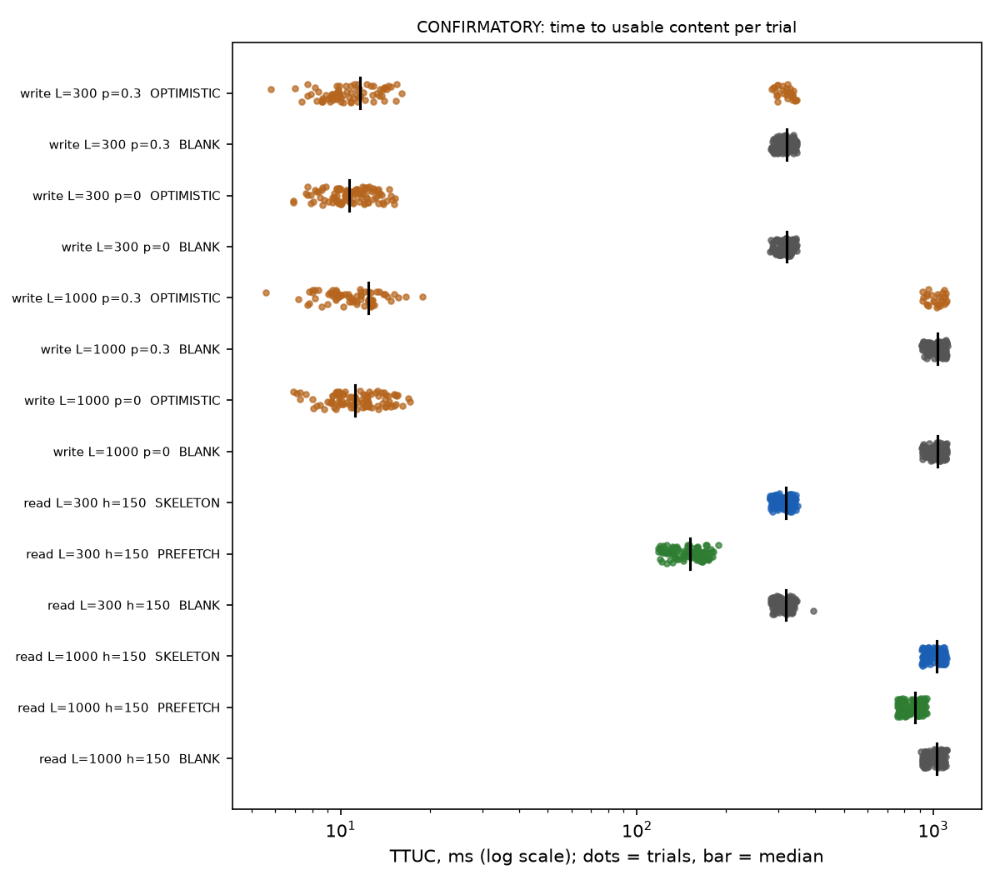
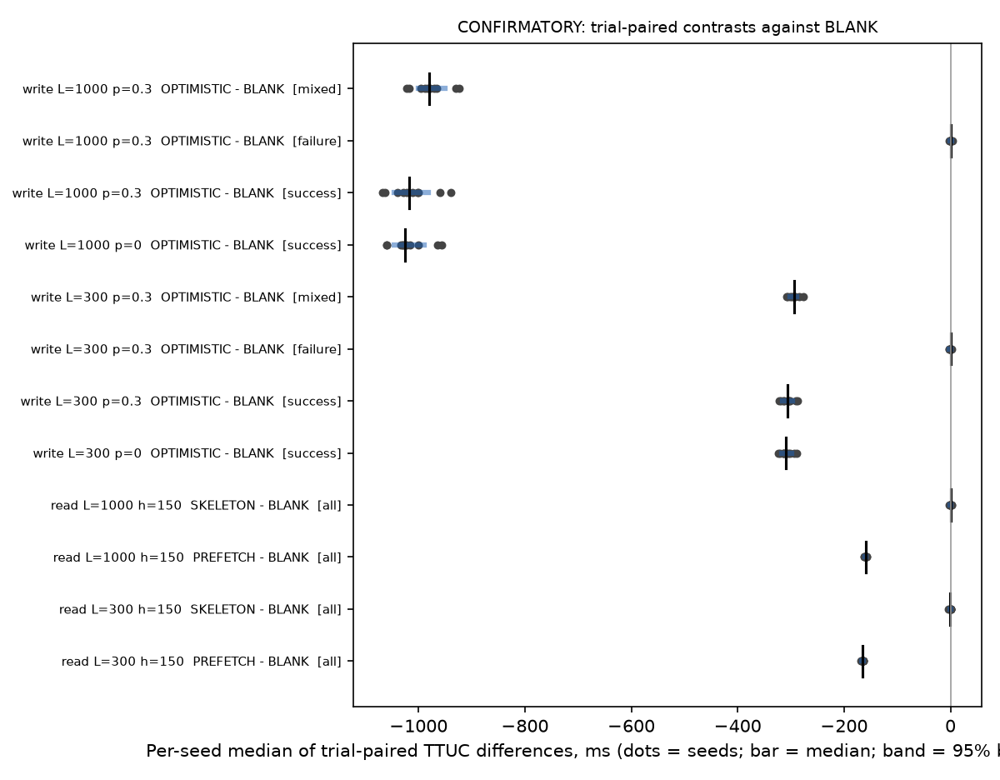
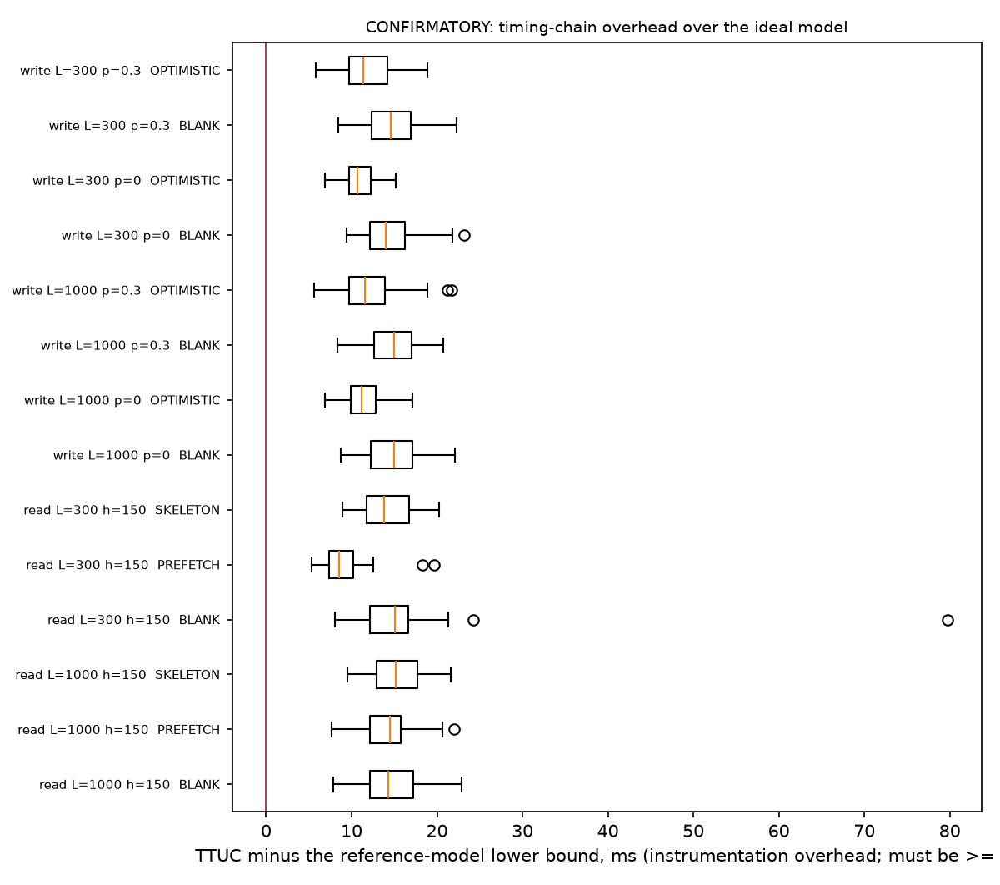

<!-- SPDX-License-Identifier: LicenseRef-SCROLL-NC-Research-1.0 -->
# CONFIRMATORY run report: EXP-004-20261125T110537Z

Generated by `python -m scroll report` from `results.json` (SHA-256 `0df4a90fa1a334fae11450917b7d02cd39b7a98d874652c6c382ca187343d317`). Every number below is computed from that file.

## Run

| Experiment | Config hash (prefix) | Code revision | Browser | Runtime (s) | Load avg start | Load avg end | Peak RSS Python (MiB) |
|---|---|---|---|---|---|---|---|
| EXP-004 | 7c7b667ce8baebb2 | b5a72c3220 | chrome 158.0.8127.38 headless=False cpu=1x | 2676.1 | [2.19, 2.42, 2.28] | [1.64, 1.54, 1.7] | 64.5 |

Platform: Apple M1 Pro, 10 logical CPUs, Darwin 15.3.1. Other processes (including other agents) were running during the run, so wall-clock and timing values are noisy.

## Cell summaries (trial level, descriptive)

| Cell | Arm | Trials ok | Excl. | Seeds | TTUC median (ms) | Q1 | Q3 | SD of seed medians | TTFF median | Excess min | Excess median |
|---|---|---|---|---|---|---|---|---|---|---|---|
| read L=300 h=150 | BLANK | 100 | 0 | 10 | 318.0 | 296.4 | 330.2 | 10.9 | 318.0 | 8.1 | 15.1 |
| read L=300 h=150 | PREFETCH | 100 | 0 | 10 | 151.3 | 131.8 | 165.0 | 10.7 | 151.3 | 5.3 | 8.5 |
| read L=300 h=150 | SKELETON | 100 | 0 | 10 | 317.6 | 296.3 | 329.3 | 11.0 | 10.5 | 8.9 | 13.9 |
| read L=1000 h=150 | BLANK | 100 | 0 | 10 | 1026.1 | 954.0 | 1062.9 | 37.1 | 1026.1 | 7.9 | 14.3 |
| read L=1000 h=150 | PREFETCH | 100 | 0 | 10 | 865.8 | 793.5 | 906.5 | 38.0 | 865.8 | 7.7 | 14.5 |
| read L=1000 h=150 | SKELETON | 100 | 0 | 10 | 1025.8 | 952.6 | 1064.2 | 37.4 | 10.9 | 9.5 | 15.1 |
| write L=300 p=0 | BLANK | 100 | 0 | 10 | 320.4 | 302.3 | 334.9 | 10.5 | 320.4 | 9.4 | 14.0 |
| write L=300 p=0 | OPTIMISTIC | 100 | 0 | 10 | 10.7 | 9.7 | 12.2 | 0.9 | 10.7 | 6.9 | 10.7 |
| write L=300 p=0.3 | BLANK | 100 | 0 | 10 | 319.3 | 300.8 | 334.9 | 10.0 | 319.3 | 8.4 | 14.6 |
| write L=300 p=0.3 | OPTIMISTIC | 100 | 0 | 10 | 11.6 | 9.8 | 291.3 | 1.5 | 10.8 | 5.8 | 11.4 |
| write L=1000 p=0 | BLANK | 100 | 0 | 10 | 1033.1 | 965.3 | 1082.1 | 35.9 | 1033.1 | 8.7 | 14.9 |
| write L=1000 p=0 | OPTIMISTIC | 100 | 0 | 10 | 11.2 | 9.9 | 12.8 | 0.4 | 11.2 | 6.9 | 11.2 |
| write L=1000 p=0.3 | BLANK | 100 | 0 | 10 | 1033.2 | 963.8 | 1080.9 | 35.4 | 1033.2 | 8.3 | 14.9 |
| write L=1000 p=0.3 | OPTIMISTIC | 100 | 0 | 10 | 12.4 | 9.8 | 933.0 | 1.9 | 10.6 | 5.6 | 11.5 |

| Cell | Arm | Element - rAF2 (ms) | Event <16 ms share (descriptive) | Input to handler (ms) | Hover-lead excl. | Shift all (median) | Shift CLS-eligible (median) | Wrong-state (ms) | False-state (ms) | Failures | Final correct | Prefetch hit | Defects |
|---|---|---|---|---|---|---|---|---|---|---|---|---|---|
| read L=300 h=150 | BLANK | 20.000 | 1.000 | 0.300 | 0 | 0.035 | 0.000 | n/a | n/a | 0 | 1.000 | n/a | 0 |
| read L=300 h=150 | PREFETCH | 19.650 | 1.000 | 0.300 | 0 | 0.035 | 0.000 | n/a | n/a | 0 | 1.000 | 1.000 | 0 |
| read L=300 h=150 | SKELETON | 19.050 | 0.000 | 0.300 | 0 | 0.035 | 0.000 | n/a | n/a | 0 | 1.000 | n/a | 0 |
| read L=1000 h=150 | BLANK | 19.900 | 1.000 | 0.300 | 0 | 0.035 | 0.035 | n/a | n/a | 0 | 1.000 | n/a | 0 |
| read L=1000 h=150 | PREFETCH | 19.350 | 1.000 | 0.300 | 0 | 0.035 | 0.035 | n/a | n/a | 0 | 1.000 | 1.000 | 0 |
| read L=1000 h=150 | SKELETON | 18.500 | 0.000 | 0.350 | 0 | 0.035 | 0.000 | n/a | n/a | 0 | 1.000 | n/a | 0 |
| write L=300 p=0 | BLANK | n/a | 1.000 | 0.300 | 0 | 0.000 | 0.000 | 320.450 | 0.000 | 0 | 1.000 | n/a | 0 |
| write L=300 p=0 | OPTIMISTIC | n/a | 0.000 | 0.300 | 0 | 0.000 | 0.000 | 10.700 | 0.000 | 0 | 1.000 | n/a | 0 |
| write L=300 p=0.3 | BLANK | n/a | 1.000 | 0.300 | 0 | 0.000 | 0.000 | 303.400 | 0.000 | 28 | 1.000 | n/a | 0 |
| write L=300 p=0.3 | OPTIMISTIC | n/a | 0.000 | 0.300 | 0 | 0.000 | 0.000 | 11.600 | 0.000 | 28 | 1.000 | n/a | 0 |
| write L=1000 p=0 | BLANK | n/a | 1.000 | 0.300 | 0 | 0.000 | 0.000 | 1033.100 | 0.000 | 0 | 1.000 | n/a | 0 |
| write L=1000 p=0 | OPTIMISTIC | n/a | 0.000 | 0.300 | 0 | 0.000 | 0.000 | 11.200 | 0.000 | 0 | 1.000 | n/a | 0 |
| write L=1000 p=0.3 | BLANK | n/a | 1.000 | 0.300 | 0 | 0.000 | 0.000 | 986.550 | 0.000 | 28 | 1.000 | n/a | 0 |
| write L=1000 p=0.3 | OPTIMISTIC | n/a | 0.000 | 0.300 | 0 | 0.000 | 0.000 | 12.400 | 0.000 | 28 | 1.000 | n/a | 0 |

## Primary estimand: trial-paired contrasts (amendments A1 and A2)

Unit: the seed. Within a seed and cell, interaction k of an arm is paired with interaction k of BLANK (same scheduled delay and outcome); the seed contributes the median of its paired differences. Write cells with p > 0 are split by outcome (success, failure; primary) and also shown mixed (secondary). Intervals are 95% percentile bootstrap over seeds (10,000 resamples, seed 20261124).

| Cell | Contrast | Stratum | Role | Seeds | Trial pairs | Median diff (ms) | CI low | CI high | sigma_d (ms) | n req. |
|---|---|---|---|---|---|---|---|---|---|---|
| read L=300 h=150 | PREFETCH - BLANK | all | primary | 10 | 100 | -164.8 | -166.3 | -163.5 | 1.6 | 1 |
| read L=300 h=150 | SKELETON - BLANK | all | primary | 10 | 100 | -0.1 | -0.6 | 0.6 | 1.2 | 1 |
| read L=1000 h=150 | PREFETCH - BLANK | all | primary | 10 | 100 | -159.6 | -161.1 | -158.5 | 1.7 | 1 |
| read L=1000 h=150 | SKELETON - BLANK | all | primary | 10 | 100 | 0.4 | -0.7 | 1.5 | 1.4 | 1 |
| write L=300 p=0 | OPTIMISTIC - BLANK | success | primary | 10 | 100 | -310.2 | -316.9 | -299.2 | 10.8 | 4 |
| write L=300 p=0.3 | OPTIMISTIC - BLANK | success | primary | 10 | 72 | -305.7 | -316.1 | -297.4 | 11.2 | 4 |
| write L=300 p=0.3 | OPTIMISTIC - BLANK | failure | primary | 9 | 28 | 0.4 | -2.7 | 0.9 | 1.8 | 1 |
| write L=300 p=0.3 | OPTIMISTIC - BLANK | mixed | secondary | 10 | 100 | -294.2 | -301.6 | -288.6 | 9.8 | 3 |
| write L=1000 p=0 | OPTIMISTIC - BLANK | success | primary | 10 | 100 | -1025.6 | -1045.3 | -989.9 | 35.2 | 34 |
| write L=1000 p=0.3 | OPTIMISTIC - BLANK | success | primary | 10 | 72 | -1017.0 | -1046.4 | -981.4 | 41.1 | 46 |
| write L=1000 p=0.3 | OPTIMISTIC - BLANK | failure | primary | 9 | 28 | 0.0 | -1.3 | 2.8 | 2.1 | 1 |
| write L=1000 p=0.3 | OPTIMISTIC - BLANK | mixed | secondary | 10 | 100 | -980.8 | -1000.4 | -950.8 | 32.4 | 29 |

## Secondary: draft seed-median estimand (descriptive)

Each seed contributes the median TTUC of its session; differences are arm minus BLANK for the same seed and cell. Intervals are 95% percentile bootstrap over seeds (10,000 resamples, seed 20261124). `n req.` is the protocol 5.1 formula with delta = 17 ms, alpha 0.05, power 0.80.

| Cell | Contrast | Pairs | Median diff (ms) | CI low | CI high | sigma_d (ms) | sigma_d CI high | n req. | n req. (CI high) | Median diff, rAF1 | Median diff, Element |
|---|---|---|---|---|---|---|---|---|---|---|---|
| read L=300 h=150 | PREFETCH - BLANK | 10 | -164.8 | -166.2 | -163.3 | 2.2 | 2.9 | 1 | 1 | -158.8 | -162.6 |
| read L=300 h=150 | SKELETON - BLANK | 10 | -0.6 | -1.8 | 0.7 | 1.6 | 2.0 | 1 | 1 | -0.4 | -0.5 |
| read L=1000 h=150 | PREFETCH - BLANK | 10 | -159.0 | -161.2 | -157.0 | 2.8 | 3.3 | 1 | 1 | -160.3 | -158.8 |
| read L=1000 h=150 | SKELETON - BLANK | 10 | 2.0 | 0.3 | 3.4 | 2.6 | 3.7 | 1 | 1 | -0.2 | 0.8 |
| write L=300 p=0 | OPTIMISTIC - BLANK | 10 | -310.3 | -317.3 | -299.6 | 11.0 | 13.7 | 4 | 6 | -303.0 | n/a |
| write L=300 p=0.3 | OPTIMISTIC - BLANK | 10 | -308.8 | -315.8 | -297.5 | 10.8 | 13.6 | 4 | 6 | -302.1 | n/a |
| write L=1000 p=0 | OPTIMISTIC - BLANK | 10 | -1024.2 | -1045.9 | -989.4 | 36.0 | 45.7 | 36 | 57 | -1019.1 | n/a |
| write L=1000 p=0.3 | OPTIMISTIC - BLANK | 10 | -1023.0 | -1043.1 | -988.0 | 35.0 | 44.5 | 34 | 54 | -1017.9 | n/a |

## Degenerate cases and warnings

- read L=300 h=150 BLANK: Event Timing duration below the 16 ms threshold in 100% of trials (metric mostly unobservable; descriptive only, amendment A4).
- read L=300 h=150 PREFETCH: Event Timing duration below the 16 ms threshold in 100% of trials (metric mostly unobservable; descriptive only, amendment A4).
- read L=1000 h=150 BLANK: Event Timing duration below the 16 ms threshold in 100% of trials (metric mostly unobservable; descriptive only, amendment A4).
- read L=1000 h=150 PREFETCH: Event Timing duration below the 16 ms threshold in 100% of trials (metric mostly unobservable; descriptive only, amendment A4).
- write L=300 p=0 BLANK: Event Timing duration below the 16 ms threshold in 100% of trials (metric mostly unobservable; descriptive only, amendment A4).
- write L=300 p=0.3 BLANK: Event Timing duration below the 16 ms threshold in 100% of trials (metric mostly unobservable; descriptive only, amendment A4).
- write L=1000 p=0 BLANK: Event Timing duration below the 16 ms threshold in 100% of trials (metric mostly unobservable; descriptive only, amendment A4).
- write L=1000 p=0.3 BLANK: Event Timing duration below the 16 ms threshold in 100% of trials (metric mostly unobservable; descriptive only, amendment A4).
- write L=300 p=0.3 BLANK: failures per session [4, 4, 2, 3, 4, 3, 3, 0, 4, 1] of K=10; the per-seed median TTUC reflects only successes in some seeds.
- write L=300 p=0.3 OPTIMISTIC: failures per session [4, 4, 2, 3, 4, 3, 3, 0, 4, 1] of K=10; the per-seed median TTUC reflects only successes in some seeds.
- write L=1000 p=0.3 BLANK: failures per session [4, 4, 2, 3, 4, 3, 3, 0, 4, 1] of K=10; the per-seed median TTUC reflects only successes in some seeds.
- write L=1000 p=0.3 OPTIMISTIC: failures per session [4, 4, 2, 3, 4, 3, 3, 0, 4, 1] of K=10; the per-seed median TTUC reflects only successes in some seeds.

## Runtime and projection

Fitted on this run: per-trial overhead median 0.060 s (90th percentile 0.070 s) beyond delay + settle + pre-input + hover lead; per-session overhead median 0.190 s; median session wall 18.52 s; median trial wall 1.897 s. Projections use the nominal latency as the delay and do not model CPU throttling or headed-mode cost.

| Experiment | Config | Sessions | Interactions | Projected (min) |
|---|---|---|---|---|
| EXP-002 | EXP-002 read path (frozen v1.0, owner-approved 2026-11-24). | 240 | 2400 | 65.7 |
| EXP-003 | EXP-003 write path (frozen v1.0, owner-approved 2026-11-24). | 360 | 3600 | 104.7 |
| EXP-004 | EXP-004 sensitivity S2, CPU throttle 4x (frozen v1.0, owner-approved 2026-11-24). | 140 | 1400 | 45.0 |
| EXP-004 | EXP-004 sensitivity S3, prefetch lead time (frozen v1.0, owner-approved 2026-11-24; S1 reuses EXP-002/003 data; S2 and S4 are browser-setting variants). | 80 | 800 | 27.7 |
| EXP-004 | EXP-004 sensitivity S4, headed browser (frozen v1.0, owner-approved 2026-11-24). | 140 | 1400 | 45.0 |

## Figures

**FIG-E1.** Time to usable content (TTUC, ms, log scale) for every analysed trial, by cell and arm. Vertical bars mark medians. Exploratory pre-freeze run; trials within a session are not independent.

**FIG-E2.** Trial-paired TTUC differences (arm minus BLANK, ms): each dot is one seed's median over its paired interactions (write cells with p > 0 split by outcome), with the median over seeds and a 95% percentile bootstrap interval over seeds.

**FIG-E3.** TTUC minus the reference-model lower bound (ms) per cell and arm; boxes show quartiles over trials. Negative values would indicate an instrumentation defect.

## Files

- `../results.json` (validated against `src/scroll/schemas/result-1.0.0.json`)
- `metrics.csv`, `cell_summary.csv`, `trial_paired_contrasts.csv`, `paired_contrasts.csv`, `runtime_projection.csv`
- `figures/`

Report generated 2026-11-25T11:50:44Z.
